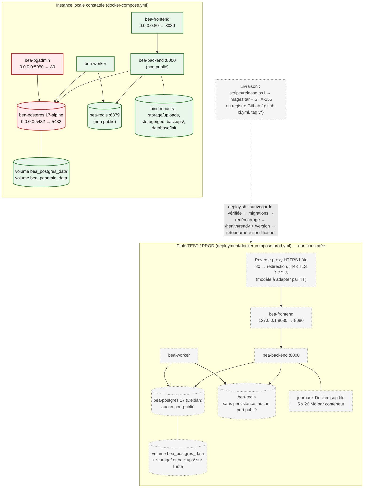

# Environnements et déploiement — BEA DIGITAL

> Audit du 22/10/2026. Distinction stricte entre **ce qui existe** (constaté), **ce qui est outillé
> mais jamais exécuté sur une infrastructure réelle**, et **les recommandations**.

## 1. Environnements

| Environnement | Existence | Description | Preuves |
|---|---|---|---|
| Développement | Constaté | Poste Windows, Docker Desktop, code dans `c:\Users\…\bea-digital`, venv Python `backend/.venv`, `node_modules` | Arborescence, `docker ps` |
| Instance locale « poste comptable » | Documentée ; l'instance de ce poste est en service | Kit USB (`scripts/install-on-comptable.ps1`, `update-on-comptable.ps1`), compose racine, accès `http://localhost`. Décrite comme **temporaire** pour la saisie des acquisitions 2026, en attendant le serveur DSI | `docs/DEPLOIEMENT_LOCAL.md` |
| Développement alternatif | Fichier présent | `docker-compose.dev.yml` (ports 5433, 6379, 8000, 8080 ; rechargement à chaud) | Fichier |
| TEST / préproduction | **Non constaté** | Modèle `deployment/env.test.example` ; aucun serveur décrit | Inventaire vide |
| Production | **Non constatée** | Compose, scripts et modèle de reverse proxy prêts ; inventaire d'infrastructure vide (OS, IP, domaine, certificats, pare-feu, sauvegardes, supervision) | `docs/deployment/00-inventaire-bea.md` |

L'instance locale en service a été construite depuis l'arbre de travail courant : `/version`
renvoie `0.0.0-local`, `git_sha` = `local`, et le conteneur contient des fichiers non commités
(`tasks_stock.py`). La version déployée n'est donc **pas traçable** à un commit.

## 2. Déploiement

Source éditable : [diagrams/06-deploiement.mmd](diagrams/06-deploiement.mmd).



*Légende : vert = constaté en fonctionnement ; rouge = constaté et exposé sur toutes les interfaces
réseau de l'hôte ; gris = cible outillée, jamais observée sur une infrastructure réelle.*

### Ports et réseaux

| Élément | Local (constaté) | TEST/PROD (déclaré) |
|---|---|---|
| Réseau Docker | `bea_internal` (bridge) | Idem |
| Port applicatif | 80 sur toutes les interfaces | 8080 sur 127.0.0.1, derrière un reverse proxy hôte 80/443 |
| PostgreSQL | 5432 sur toutes les interfaces | Non publié |
| pgAdmin | 5050 sur toutes les interfaces | Absent |
| Redis, backend | Non publiés | Non publiés |
| Volumes | `bea_postgres_data`, `bea_pgadmin_data` ; bind mounts `storage/`, `backups/`, `database/init` | `bea_postgres_data` ; `storage/`, `backups/` |

## 3. Chaîne de livraison

### 3.1 Ce qui existe dans le dépôt

| Étape | Outil | État |
|---|---|---|
| Gestion de version | Git, branche unique `main`, 165 commits depuis le 23/07/2026 ; remote `origin` = dépôt GitHub | Constaté. **Aucun tag** `v*` |
| Contrôles CI | `.github/workflows/ci.yml` : `pytest -q`, import de l'application, `ng build` développement, sur push / PR vers `main` | Fichier présent ; résultats d'exécution non consultables par l'audit |
| CI/CD cible | `.gitlab-ci.yml` : validate → test → security (scan de secrets basique) → build → publish (registre GitLab) → deploy production **manuel** par SSH vers un runner `bea-prod` | **Inactif** : pas de remote GitLab, pas de tag, pas de runner décrit |
| Livraison hors ligne | `scripts/release.ps1` : refuse un code non commité, plusieurs têtes Alembic ou une API qui ne démarre pas ; produit `images.tar` + SHA-256, manifeste, scripts | Présent ; aucune archive de version observée |
| Déploiement serveur | `deployment/scripts/deploy.sh` : refus d'une base vide → sauvegarde vérifiée → analyse de compatibilité des migrations → `alembic upgrade head` (nouvelle image) → redémarrage → contrôle `/health/ready`, `/version`, worker → retour arrière automatique **seulement** si les migrations sont déclarées compatibles | Présent ; validé sur un **serveur Linux simulé** le 20/10/2026 selon la documentation (non constaté par l'audit) |
| Retour arrière | `rollback.sh` (compare les révisions), `restore.sh` (`REMPLACER=1` sauvegarde puis remplace la base) | Présent |
| Supervision | `/health` (processus), `/health/ready` (base + Redis), `/version` ; tâche Celery d'alerte sur pic d'erreurs 5xx ; écrans CORE ADMIN | Présent ; aucune supervision externe |

### 3.2 Chemin réellement suivi aujourd'hui

D'après les éléments constatés : développement sur le poste, construction locale des images
(`docker compose build`), redémarrage des conteneurs et migrations appliquées manuellement sur la
base locale après sauvegarde (procédure décrite dans `docs/studio-integration-api.md` § 16.1). Les
mises à jour du poste comptable passent par un kit USB. **Aucune séparation TEST / PROD et aucune
validation formelle n'est démontrée.**

### 3.3 Cible recommandée (non opérationnelle)

```text
Développement (branche courte + revue)
  → Contrôles automatiques : lint (ruff), tests backend AVEC service PostgreSQL jetable,
    tests Karma, build, scan de dépendances et d'images, scan de secrets
  → Construction unique des images, tag SemVer + SHA, empreinte
  → Déploiement TEST (deploy.sh) sur une base restaurée et anonymisée
  → Recette métier et validation écrite (DSI + propriétaire métier)
  → Déploiement PROD manuel, fenêtre annoncée, sauvegarde vérifiée
  → Contrôles post-déploiement (/health/ready, /version, parcours témoins Login 1 / Login 2 / immo)
  → Retour arrière : rollback.sh si migrations compatibles, sinon restore.sh sur décision DSI
```

Les briques `release.ps1`, `deploy.sh`, `rollback.sh`, `restore.sh` et la déclaration
`retour_arriere` des migrations couvrent déjà une grande partie de cette cible ; il manque
l'infrastructure (serveurs TEST/PROD, registre, runner), les tests avec base en CI, les scans et la
gouvernance de validation.

## 4. Migrations, versions, rollback

| Sujet | Existant | Recommandation |
|---|---|---|
| Migrations | Alembic, jamais au démarrage en TEST/PROD (`SKIP_MIGRATIONS=1`), appliquées par `deploy.sh` après sauvegarde, en une transaction | Interdire toute migration manuelle hors script en PROD ; tracer la révision par version |
| Versionnement | SemVer prévu (`vMAJEUR.MINEUR.CORRECTIF`), `APP_VERSION` / `GIT_SHA` injectés au build | Créer le premier tag ; interdire les images `latest` en PROD (déjà prévu) |
| Rollback | Conditionné à la compatibilité de schéma ; restauration sinon (perte des saisies postérieures, décision DSI) | Tester un retour arrière à chaque recette |
| Sauvegarde | Avant chaque déploiement + écran CORE ADMIN ; purge 30 jours | Externaliser, chiffrer, tester une restauration périodique |

## 5. Responsabilités d'exploitation (à formaliser)

| Activité | Existant | À désigner |
|---|---|---|
| Administration système et réseau du serveur | Non défini | DSI |
| Exécution des déploiements | Scripts prévus pour un compte `bea-deploy` sans privilèges globaux | DSI / équipe BEA DIGITAL |
| Validation des mises en production | Non défini | DSI + métier |
| Sauvegardes externes et tests de restauration | Non défini | DSI |
| Supervision et astreinte | Non défini | DSI |
| Administration fonctionnelle (CORE ADMIN) | Un compte superuser localement | Gouvernance des comptes à définir |
