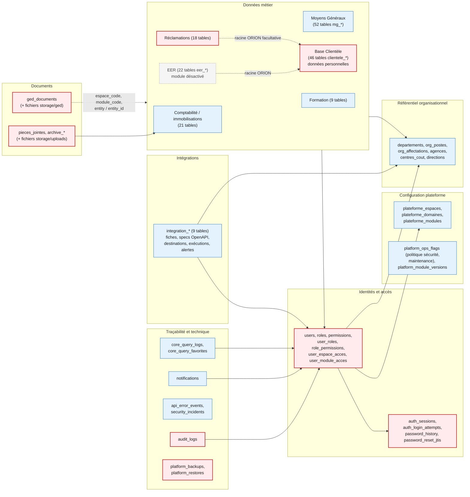

# Architecture des données — BEA DIGITAL

> Audit du 22/10/2026. Les chiffres proviennent des modèles SQLAlchemy (`backend/app/models/`) et
> de requêtes de **comptage** en lecture seule sur l'instance locale. Aucune donnée personnelle ou
> bancaire n'a été extraite. Le schéma complet est documenté dans `docs/db/schema.sql` et
> `docs/db/relations.md`.

## 1. Principes

- **Une seule base** PostgreSQL 17 (`bea_digital`) pour le socle et tous les modules
  (`AGENTS.md`, `docs/base-de-donnees-unique.md`). Pas de schéma séparé par module : tout est dans
  `public`, avec des préfixes de table (`mg_`, `clientele_`, `eer_`, `integration_`, …).
- **ORION reste la source de vérité** bancaire : BEA DIGITAL stocke des **copies importées** de
  données ORION (clients, comptes, soldes), datées par import, sans écriture vers ORION.
- 210 tables en base locale ; 205 classes mappées + 4 tables d'association dans le code.
- Valeurs monétaires stockées brutes ; le formatage fr-FR est appliqué à l'affichage et à l'export.

## 2. Vue conceptuelle des domaines

Source éditable : [diagrams/08-domaines-donnees.mmd](diagrams/08-domaines-donnees.mmd).

*Légende : rouge = domaine à forte sensibilité (identités, données clients, documents, journaux,
sauvegardes) ; bleu = domaine standard ; gris = module désactivé, données conservées. Flèche pleine =
clé étrangère principale ; pointillé = rattachement logique (identifiant ORION ou couple
`entity`/`entity_id`), sans contrainte d'intégrité garantie.*

## 3. Fiches par domaine

| Domaine | Tables (exemples) | Accès applicatif | Dépendances | Risques de confidentialité | Conservation / sauvegarde |
|---|---|---|---|---|---|
| Identités et accès | `users`, `roles`, `permissions`, associations | CORE ADMIN (`core.admin.users`, `.roles`, `.permissions`) ; `/users` (rôle immo `administrateur`) | Toutes les tables métier (auteurs, valideurs) | Hachages bcrypt, secrets TOTP chiffrés, e-mails | Aucune durée de conservation définie ; à confirmer |
| Sessions | `auth_sessions`, `auth_login_attempts`, `password_reset_jtis` | Interne (deps), CORE ADMIN Sessions | `users` | IP, user-agent, identifiants de jeton | Pas de purge identifiée pour les sessions expirées — à confirmer |
| Configuration plateforme | `plateforme_*`, `platform_ops_flags`, `platform_module_versions` | CORE ADMIN ; synchronisation additive du catalogue au démarrage | Gardes d'accès | Faible | Incluses dans les sauvegardes globales |
| Référentiel organisationnel | `departements`, `org_postes`, `org_affectations`, `agences`, `centres_cout` | CORE ADMIN Organisation ; lecture `/organisation/*` | Tous modules via `org_entite_id` | Affectations nominatives | — |
| Traçabilité | `audit_logs`, `notifications`, `api_error_events`, `security_incidents`, `core_query_logs` | CORE ADMIN Audit / Activité / Erreurs | `users` | Valeurs avant / après des objets audités (peuvent contenir des données personnelles), IP | `api_error_events` purgée par tâche planifiée ; aucune politique de rétention pour `audit_logs` — à définir |
| Documents | `ged_documents` + `storage/ged` ; `pieces_jointes`, `archive_*` + `storage/uploads` | `/documents`, `/ged`, archives des modules (permissions `ged.*`, `mg.archives.*`, `archives.general.*`) | Modules métier, OCR | Pièces justificatives, factures, feuilles signées ; texte OCR indexé en clair | Fichiers sur le disque hôte, sauvegardés avec la base par les scripts ; pas de chiffrement au repos |
| Comptabilité / immobilisations | `immobilisations`, `amortissements`, `ecritures_comptables`, `plan_comptable`, `exercices_comptables`, `soldes_compte_orion`, `cessions`, `rebuts`, `reevaluations` | Login 2 `immobilisations` | Référentiels, ORION (saisie de soldes) | Données financières internes | Archives annuelles (`archive_*`), exercice 2025 à ne pas recalculer |
| Moyens Généraux | `mg_articles`, `mg_stock_*`, `mg_achat_*`, `mg_notes_frais`, `mg_contrats`, `mg_points_facturation`, `mg_employee_requests` | Login 2 des modules MG | Org, GED, fournisseurs | Notes de frais nominatives, coordonnées fournisseurs | — |
| Base Clientèle | `clientele_clients`, `clientele_comptes`, `clientele_imports`, `clientele_classifications`, `clientele_kyc`, `clientele_declarations_bcm`, `clientele_declarations_sic`, `clientele_filtrage_*` | Login 2 `clientele`, 23 permissions | Imports ORION (fichiers), référentiels BCM/SIC | **Très élevé** : identité, NIF/NNI, nationalité, comptes, RIB, classification LBC-FT | Aucune suppression d'un client absent d'un import (règle métier) ; rétention non définie |
| EER | `eer_dossiers`, `eer_parties*`, `eer_pieces_identite`, `eer_decisions` | Module désactivé ; tables lues par la SIC | Base Clientèle | **Très élevé** (KYC) | Conservées ; ne pas supprimer |
| Formation | `formation_employes`, `formation_sessions`, `formation_participants` | Login 2 `formation` | GED | Données d'employés | — |
| Réclamations | `reclamations`, `reclamation_comptes`, `reclamation_documents`, `reclamation_evenements` | Login 2 `reclamations` | Base Clientèle, GED | Élevé : client, comptes, opérations contestées | Suppression définitive possible par l'administrateur du module (documentée) |
| Intégrations | `integration_clients`, `integration_fournisseurs`, `integration_destinations`, `integration_executions`, `integration_alertes` | CORE ADMIN Studio (permissions non attribuées) | Org, utilisateurs | Faible : aucune colonne de secret par conception ; extraits de réponse assainis | Rétention d'exécutions documentée à 90 jours, purge non automatique |
| Sauvegardes | `platform_backups` + fichiers `backups/` | CORE ADMIN Continuité | Toute la base | **Très élevé** : copie intégrale | Même disque que la base localement ; externalisation non identifiée |

## 4. Données d'authentification et de configuration

- Politique de sécurité : variables d'environnement, surchargées par `platform_ops_flags.security_policy`
  (en base), chargée en cache mémoire au démarrage (`SecurityPolicyService.ensure_cache`).
- Catalogue des modules et permissions : déclaré dans `backend/app/data/plateforme_catalogue.py`,
  synchronisé de façon additive ; CORE ADMIN reste la source de vérité pour les statuts (exemple
  constaté : `clientele` déclaré `developpement` dans le code, `actif` en base locale).

## 5. Migrations et cohérence du schéma

- 98+ révisions Alembic, une seule tête. Révisions Stock / notifications :
  `20261022_notifications_01` puis `20261022_mg_stock_alertes` (`retour_arriere = compatible`).
- La première révision suppose des tables existantes (issues de l'historique Supabase) : toute
  nouvelle instance doit partir d'un dump restauré, jamais d'une base vide.
- 31 des 93 révisions antérieures au 20/10/2026 contiennent des opérations non additives
  (`docs/deployment/08-livraison-et-mises-a-jour.md`) : un retour arrière de code n'est sûr qu'après
  analyse.

## 6. Points à confirmer

1. Classification des données (public, interne, confidentiel, secret bancaire) et propriétaires
   métier par domaine.
2. Durées de conservation et règles de purge (audit, sessions, OCR, sauvegardes, Base Clientèle).
3. Exigences de chiffrement au repos (base, fichiers, sauvegardes) et de pseudonymisation des copies
   de test (les tests documentés utilisent des copies de la base réelle).
4. Fréquence d'import ORION, responsable de l'extraction et contrôle d'intégrité des fichiers sources.
5. Localisation et protection des fichiers d'analyse nominatifs générés localement
   (`backend/storage/rapports/`, ignoré par Git mais présent sur le poste).
