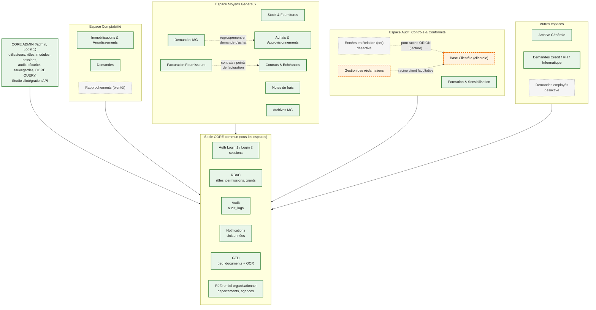

# Architecture fonctionnelle — BEA DIGITAL

> Audit du 22/10/2026. Les statuts de module proviennent de la table `plateforme_modules` de
> l'**instance locale** (lecture seule). CORE ADMIN est la source de vérité : un statut peut
> différer sur une autre instance. La présence d'un menu ou d'un module « actif » **ne prouve pas**
> que toutes ses fonctions fonctionnent : aucun parcours métier n'a été exécuté par cet audit.

## 1. Principe d'organisation

BEA DIGITAL est organisé en trois niveaux, contrôlés par le backend (`backend/app/api/deps.py`) :

```text
Utilisateur → Espace (département) autorisé → Module autorisé et actif → Permission → Accès
```

- **Espace** (`plateforme_espaces`) : département BEA DIGITAL (Comptabilité, Moyens Généraux,
  Audit Contrôle & Conformité…). À ne pas confondre avec les entités de l'organigramme
  (`departements`).
- **Domaine** (`plateforme_domaines`) : regroupement visuel, sans droit attaché.
- **Module** (`plateforme_modules`) : unité fonctionnelle, avec un statut (`actif`, `inactif`,
  `bientot`, `developpement`) modifiable dans CORE ADMIN.
- **Login 1** ouvre la plateforme ; **Login 2** (nouvelle saisie des identifiants) ouvre un module,
  uniquement si la session Login 1 est encore valide.

## 2. Vue fonctionnelle

Source éditable : [diagrams/04-fonctionnel.mmd](diagrams/04-fonctionnel.mmd).



*Légende : vert = module actif en base locale ; orange = actif mais documenté « en construction » ;
gris = désactivé ou « bientôt ». Flèches pleines = dépendance au socle ; pointillées = échange de
données entre modules.*

## 3. Matrice récapitulative

Définition des états utilisés :

- **Actif — non vérifié par l'audit** : module actif en base locale, code et tests présents, aucun
  parcours métier exécuté ici.
- **Actif — usage déclaré** : idem, avec une utilisation réelle affirmée par la documentation (non
  constatée par l'audit).
- **Partiel / en construction** : actif, mais la documentation décrit des phases non terminées ou des
  fonctions verrouillées.
- **Désactivé** : statut `inactif`, tables conservées.
- **Bientôt** : carte affichée sans module fonctionnel.

| Module (code) | Espace | État | Routes front | API (`/api/v1`) | Endpoints | Tables principales | Dépendances communes |
|---|---|---|---|---|---|---|---|
| CORE ADMIN | Plateforme | Actif — non vérifié par l'audit | `/admin/*` | `/plateforme/admin/*` et `/plateforme/*` | ~145 (hors Studio) | `users`, `roles`, `permissions`, `auth_sessions`, `audit_logs`, `platform_*`, `security_*`, `core_query_*` | Tout le socle |
| Studio d'intégration API | Plateforme (CORE ADMIN) | Partiel : configuration et tests TEST seulement ; aucune intégration en service | `/admin/integrations/*` | `/plateforme/admin/integrations/*` | 56 | `integration_*` (9 tables) | Auth Login 1, RBAC, audit, Redis (quotas) |
| Immobilisations & Amortissements (`immobilisations`) | Comptabilité | Actif — usage déclaré (saisie des acquisitions 2026, `docs/DEPLOIEMENT_LOCAL.md`) | Racine figée : `/dashboard`, `/immobilisations`, `/amortissements`, `/ecritures`, `/cessions`, `/rebuts`, `/reevaluations`, `/archives/:annee`, `/comptes`, … | Sans préfixe : immobilisations, comptabilité, opérations, reporting, archives, exercices, organisation | ~110 | `immobilisations`, `amortissements`, `ecritures_comptables`, `plan_comptable`, `exercices_comptables`, `soldes_compte_orion`, `cessions`, `rebuts`, `reevaluations`, `archive_*`, `pieces_jointes` | Auth, RBAC, audit, notifications, moteur VNC figé |
| Demandes (`demandes-comptabilite`, `-credit`, `-rh`, `-informatique`, `-mg`) | Plusieurs espaces | Actif — non vérifié par l'audit | `/demandes-*`, `/mes-demandes`, `/regroupements` | `/me/requests`, `/mg/requests`, `/mg/batches` | 39 | `mg_employee_requests`, `mg_request_*`, `mg_procurement_batch*` | Auth, RBAC, notifications |
| Demandes employés (`demandes-employes`) | Employé | Désactivé | `/demandes-employes` | idem | — | idem | — |
| Stock & Fournitures (`stock-fournitures`) | Moyens Généraux | Actif — alertes de seuil (tâche Celery quotidienne + écran `/alertes`) | `/stock-fournitures/*` | `/mg/stock/*` | 87 | `mg_articles`, `mg_stock_mouvements`, `mg_stock_soldes`, `mg_inventaires`, `mg_demandes_fourniture`, `mg_stock_alertes` | Référentiel org, notifications, Celery (seuils) |
| Achats & Approvisionnements (`achats-appro`) | Moyens Généraux | Actif — non vérifié ; indicateur `ACHATS_MODE_TEST` à couper avant production (valeur 0 localement) | `/achats-appro/*` | `/mg/achats/*` | 79 | `mg_achat_*` (15 tables) | GED, notifications |
| Notes de frais (`notes-frais`) | Moyens Généraux | Actif — non vérifié | `/notes-frais/*` | `/mg/notes-frais/*` | 27 | `mg_notes_frais`, `mg_note_frais_*` | Audit, notifications |
| Contrats & Échéances (`contrats-echeances`) | Moyens Généraux | Actif — non vérifié ; rappels e-mail inactifs (pas de SMTP) | `/contrats-echeances/*` | `/mg/contrats/*` | 38 | `mg_contrats`, `mg_contrat_*` | Celery (rappels), SMTP optionnel |
| Facturation Fournisseurs (`facturation-fournisseurs`) | Moyens Généraux | Actif — non vérifié | `/facturation-fournisseurs/*` | `/mg/factures/*`, `/mg/points-facturation/*` | 50 | `mg_points_facturation`, `mg_facturation_profils`, `mg_facturation_tva` | Contrats, GED |
| Archives MG (`archives-mg`) | Moyens Généraux | Actif — non vérifié | `/archives-mg/*` | `/mg/archives/*` | 15 | `ged_documents` (filtre espace) | GED, OCR |
| Archive Générale (`archives-generales`) | Archives | Actif — non vérifié | `/archives-generales/*` | `/doc-archives/*` | 9 | `ged_documents` | GED, OCR |
| GED / Document Service | CORE | Actif — non vérifié ; dépôt métier « à brancher » selon `AGENTS.md` | Via modules et `/admin/ged/*` | `/documents/*`, `/ged/*` | 19 | `ged_documents` | Stockage fichiers, Celery OCR |
| Base Clientèle (`clientele`) — « Clientèle » et « Base Clientèle » désignent le **même** module | Audit, Contrôle & Conformité | Partiel / en construction : actif en base locale, statut par défaut du catalogue = `developpement` ; classement de masse verrouillé (`CLIENTELE_CLASSEMENT_MASSE_ACTIF=false`) | `/clientele/*` | `/clientele/*` | 166 | `clientele_*` (46 tables) | Imports ORION (fichiers), GED, audit |
| Entrées en Relation (`eer`) | Audit, Contrôle & Conformité | Désactivé le 19/10/2026 (réversible, tables `eer_*` conservées et lues par la SIC) | `/eer/*` | `/eer/*` | 59 | `eer_*` (22 tables) | Base Clientèle (pont racine) |
| Formation & Sensibilisation (`formation`) | Audit, Contrôle & Conformité | Actif — non vérifié | `/formation/*` | `/formation/*` | 44 | `formation_*` (9 tables) | GED (feuilles signées), audit |
| Gestion des réclamations (`reclamations`) | Audit, Contrôle & Conformité | Partiel / en construction (documenté ainsi dans `docs/conformite/README.md`) | `/reclamations/*` | `/reclamations/*` | 55 | `reclamation*` (18 tables) | Base Clientèle (racine facultative), GED |
| Rapprochements, contrôles, clôture, reporting comptable, dossiers crédit, RH, tickets SI, achats (ancien espace) | Divers | Bientôt (cartes sans module) | — | — | — | — | — |

Le nombre d'endpoints est un comptage des décorateurs de route par fichier au 22/10/2026 (ordre de
grandeur, pas un inventaire contractuel).

## 4. Fiches par module

### 4.1 CORE ADMIN

- **Objectif** : piloter la plateforme (utilisateurs, rôles, permissions, espaces, modules,
  organigramme, sessions, audit, sécurité, maintenance, sauvegardes, supervision).
- **Fonctions notables** : matrice d'accès ; révocation de sessions ; politique de sécurité éditable
  (stockée dans `platform_ops_flags.security_policy`) ; sauvegardes et **restaurations depuis
  l'interface** (`pg_dump` / `pg_restore` exécutés par le conteneur backend) ; **CORE QUERY**
  (exploration en lecture seule, plus un mode administrateur en écriture, voir
  [architecture-securite.md](architecture-securite.md)) ; supervision des erreurs API.
- **Accès** : Login 1 et permissions `core.admin.*` (47 permissions `core.*` en base locale).
  Distinct du rôle immobilisations `administrateur`. Instance locale : un compte superuser.
- **Preuves** : `backend/app/api/v1/endpoints/core_admin_*.py`, `docs/core-admin.md`,
  `docs/core-admin-ops.md`, `docs/core-query.md`.

### 4.2 Studio d'intégration API (section de CORE ADMIN)

- **Objectif** : documenter et gouverner les API, sans ouvrir d'accès machine-à-machine.
- **État réel par phase** (`docs/studio-integration-api.md`) :
  1. Catalogue et console de lecture : console limitée à 4 opérations GET internes, appel en mémoire
     (ASGI), sans réseau.
  2. Fiches « applications clientes » : gouvernance uniquement, **aucun secret ni jeton émis**.
  3. Authentification M2M : **arrêtée**, en attente d'une décision DSI (module préparatoire non branché).
  4. Fournisseurs d'API externes et import OpenAPI : configuration seulement, aucun appel.
  5. Exécution de tests GET/HEAD vers une destination TEST approuvée, HTTPS 443, protections SSRF.
  6. Supervision des exécutions et alertes (aucune sonde automatique).
- **Accès** : 18 permissions `core.admin.integrations.*`, attribuées à **aucun** rôle (superuser
  implicite).
- **Constat** : aucune destination ni exécution réelle n'a été observée par l'audit.

### 4.3 Immobilisations & Amortissements

- **Objectif** : registre des immobilisations, calcul des amortissements, écritures comptables,
  cessions, rebuts, réévaluations, inventaire, archives annuelles, rapprochement avec les soldes ORION.
- **Accès** : Login 2 du module `immobilisations` ; 12 permissions `immobilisations.*` ; rôles
  historiques à codes courts (`administrateur`, `auditeur`, `comptable`, `consultation`, `creation`,
  `lecture_seule`, `modification`, `validation`).
- **Particularités** : URLs front à la racine (contrat figé) ; moteur
  `backend/app/services/amortissement_engine.py` et règle VNC à ne pas modifier.

### 4.4 Moyens Généraux

Sept modules (Stock, Achats, Notes de frais, Contrats, Facturation fournisseurs, Archives MG,
Demandes MG), 83 permissions `mg.*`. Rôles par module (`stock-fournitures.magasinier`,
`achats-appro.acheteur`, `notes-frais.redacteur`, `*.valideur`, `*.lecteur`, `*.admin`…).
Documentation : `docs/moyens-generaux/`. Alertes de seuil : migration `20261022_mg_stock_alertes`,
tâche planifiée `tasks_stock.py` (07:00), écran `/stock-fournitures/alertes`.

### 4.5 Audit, Contrôle & Conformité

- **Base Clientèle** : référentiel client consolidé sur la racine ORION (1 client, N comptes, N RIB),
  import de l'« État des comptes ORION » et d'un fichier hebdomadaire, classification des risques
  (moteur SCORE, décisions manuelles prioritaires), filtrage, déclarations BCM et SIC (exports).
  Rôles `clientele.lecteur|gestionnaire|admin`, 23 permissions.
- **EER** : complet côté application selon la documentation, mais **désactivé** depuis le
  19/10/2026 ; ne pas supprimer les tables (`docs/conformite/eer-desactivation.md`).
- **Formation** : remplace un fichier Excel de suivi ; feuilles de présence signées en GED.
- **Réclamations** : circuit de traitement (réception, qualification, affectation, réponse, clôture),
  délais, tableau de bord ; rôles `reclamations.point_reception|agent_sr|responsable_sr|…`.

## 5. Dépendances communes

| Composant commun | Utilisé par | Mécanisme |
|---|---|---|
| Authentification Login 1 / Login 2 | Tous | `auth_sessions` (parent / enfant) |
| RBAC | Tous | `require_permission`, `require_module_access` |
| Audit | Tous (actions sensibles, exports, connexions) | `record_audit` → `audit_logs` |
| Notifications | Tous ; cloisonnées par portée (`module`, `plateforme`, `core_admin`) | `notifications` (+ colonne `portee`, migration non commitée `20261022_notifications_01`) |
| GED | Archives, Formation, Achats, Réclamations, EER, Facturation | `DocumentIngestService` → `ged_documents` + OCR Celery |
| Référentiel organisationnel | Stock, Studio, Réclamations, etc. | `org_entite_id` → `departements` |
| Exports | Tous | openpyxl / reportlab, format de montant fr-FR unique |
