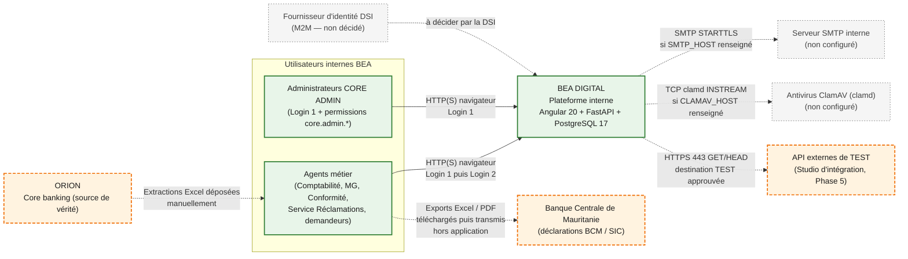

# Dossier d’architecture générale — BEA DIGITAL

| | |
|---|---|
| **Document** | Architecture générale de la plateforme interne BEA DIGITAL |
| **Destinataire** | Directeur des Systèmes d’Information, Banque El Amana (Mauritanie) |
| **Émetteur** | Audit technique du dépôt `bea-digital` |
| **Date** | 22 octobre 2026 |
| **Version du document** | 1.0 — audit documentaire |
| **Révision de code** | Branche `main` (dossier d’architecture + Stock alertes / notifications) |
| **Nature** | Lecture seule. Aucune modification applicative, aucune migration, aucun déploiement. |
| **Limite** | Ce dossier décrit ce que le code et la configuration **montrent**. Il n’atteste ni la conformité réglementaire, ni le bon fonctionnement de chaque écran métier. |

---

## 1. Page de garde — objet du dossier

BEA DIGITAL est la **plateforme interne complémentaire** de Banque El Amana. Elle digitalise des
processus aujourd’hui gérés hors du cœur bancaire (Excel, contrôles, workflows, reporting, GED).
**ORION reste le core banking et la source de vérité.** BEA DIGITAL n’est pas un remplacement
d’ORION et ne lui écrit rien.

Ce dossier sert de base à une revue d’architecture avec la DSI. Il s’appuie exclusivement sur des
preuves (code, configuration, migrations, tests, documentation, observation en lecture seule de
l’instance locale). Toute information non vérifiable est signalée.

Documents détaillés : [architecture-fonctionnelle.md](architecture-fonctionnelle.md),
[architecture-technique.md](architecture-technique.md),
[architecture-securite.md](architecture-securite.md),
[architecture-donnees.md](architecture-donnees.md),
[architecture-deploiement.md](architecture-deploiement.md),
[flux-integrations.md](flux-integrations.md),
[risques-et-recommandations.md](risques-et-recommandations.md).

---

## 2. Résumé exécutif

BEA DIGITAL est une application unique : un navigateur ouvre une interface Angular 20, qui
s’adresse via nginx à une API FastAPI (Python 3.13), elle-même persistée dans **une seule**
PostgreSQL 17. Un worker Celery et Redis assurent l’OCR, quelques tâches planifiées et
l’anti-doublon. Le tout tourne aujourd’hui en **conteneurs Docker sur un poste Windows**, en HTTP,
avec PostgreSQL et pgAdmin publiés sur le réseau local.

La plateforme est organisée en **espaces** (départements) et **modules**. L’authentification a deux
niveaux : Login 1 (plateforme) puis Login 2 (module). Les droits sont contrôlés **côté serveur**.
Le premier module opérationnel déclaré est **Immobilisations & Amortissements**. Les modules
Moyens Généraux, Formation, Base Clientèle et Réclamations sont actifs en base locale ; EER est
désactivé (données conservées). Le **Studio d’intégration API** documente les routes et prépare des
tests d’API externes : il **n’émet aucun jeton d’application** et n’appelle pas ORION.

**Il n’existe aucune connexion technique à ORION.** Les données bancaires entrent par dépôt
manuel de fichiers Excel. Les déclarations BCM / SIC sont des **exports téléchargés**, pas un
envoi automatique.

Les scripts de déploiement TEST/PROD (sauvegarde, migrations, contrôle de santé, retour arrière)
sont **écrits et documentés**, validés sur un serveur Linux simulé selon la documentation. Aucun
serveur TEST ou PROD n’a été observé. L’inventaire d’infrastructure DSI est vide.

Les risques prioritaires sont l’exposition réseau de l’instance actuelle, le compte PostgreSQL
superuser, l’absence de MFA imposée pour CORE ADMIN, des sauvegardes uniquement locales, et
l’absence d’environnements TEST/PROD.

---

## 3. Périmètre et objectifs

| Inclus | Exclu |
|---|---|
| Structure technique et fonctionnelle du dépôt | Conception d’une architecture théorique |
| Technologies et versions constatées | Affirmation qu’une fonction « marche » sans preuve |
| Modules, routes, tables, dépendances | Extraction de données personnelles ou bancaires |
| Flux réellement implémentés | Invention de serveurs, IP, certificats, HA |
| Contrôles de sécurité présents dans le code | Attestation de conformité (ISO, PCI, LBC-FT…) |
| Scripts et modèles de déploiement | Déploiement, migration, correction |

Objectifs pour la DSI : comprendre ce qui existe, ce qui est partiel, ce qui est prévu ; disposer
d’une liste de questions de revue ; disposer d’une base pour décider TEST, PROD, HTTPS, ORION.

---

## 4. Vue générale

Source : [diagrams/01-contexte.mmd](diagrams/01-contexte.mmd).



*Légende : vert = existant ; orange pointillé = partiel ou à confirmer ; gris = prévu / non
configuré. Trait plein = flux applicatif ; pointillé = flux manuel ou conditionnel.*

Responsabilités :

| Système | Responsabilité constatée | Responsabilité à confirmer |
|---|---|---|
| BEA DIGITAL | Workflows internes, copies importées, calculs (amortissements, scoring, délais), GED, audit applicatif | Exploitation 24×7, supervision, sauvegarde externe |
| ORION | Source de vérité bancaire (déclarée) | Interfaces, fréquence d’extraction, responsabilité des écarts |
| Agent habilité | Extraction ORION, dépôt de fichiers, transmission des déclarations | Procédure écrite |
| DSI | (non encore formalisée dans le dépôt) | Serveurs, TLS, réseau, SMTP, antivirus, IdP |

---

## 5. Architecture fonctionnelle

Voir [architecture-fonctionnelle.md](architecture-fonctionnelle.md) pour la matrice complète.

Chaîne d’accès (figée) : utilisateur → espace autorisé → module autorisé et actif → permission.

Modules **actifs en base locale** le 22/10/2026 : Immobilisations, Demandes (Comptabilité, Crédit,
RH, Informatique, MG), Stock, Achats, Notes de frais, Contrats, Facturation fournisseurs, Archives
MG, Archive Générale, Base Clientèle, Formation, Réclamations.

Modules **désactivés** : EER (réversible), Demandes employés.

Modules **bientôt** : rapprochements / contrôles / clôture comptable, dossiers crédit, RH, tickets
SI, audit interne, contrôle permanent, organisation & processus.

CORE ADMIN (`/admin`) pilote utilisateurs, rôles, modules, sessions, audit, sécurité, sauvegardes,
CORE QUERY et le Studio d’intégration. Distinct du rôle immobilisations `administrateur`.

---

## 6. Architecture technique

Parcours constaté :

```text
Navigateur
  → nginx (SPA Angular 20.3 + proxy /api/)
    → FastAPI 0.115.6 / Uvicorn 0.34 (1 processus)
      → services applicatifs
        → SQLAlchemy 2.0 async / asyncpg
          → PostgreSQL 17 (base unique bea_digital)
```

Composants additionnels **constatés** : Redis 7 (broker Celery, anti-doublon, quotas Studio) ;
worker Celery 5.4 + beat (OCR Tesseract 5.5, supervision, rappels contrats, seuils stock) ;
stockage fichiers (`storage/uploads`, `storage/ged`, `backups/`) ; pgAdmin (local seulement).

Composants **non constatés** : reverse proxy HTTPS hôte, SMTP, ClamAV, IdP, haute disponibilité,
réplication PostgreSQL, SIEM.

Lecture par couche (Frontend, API, Backend, Docker, Base) : [couches.md](couches.md).
Détail, liaisons et table des technologies : [architecture-technique.md](architecture-technique.md).

---

## 7. Technologies et responsabilités

Extrait. Versions lues dans les conteneurs ou `node_modules` le 22/10/2026.

| Couche | Technologie | Version constatée | Responsable d’exploitation (à confirmer) |
|---|---|---|---|
| Interface | Angular | 20.3.26 | Équipe BEA DIGITAL (build) / DSI (hébergement) |
| Proxy | nginx | 1.27.5 | DSI (TLS hôte) / application (conteneur) |
| API | Python / FastAPI / Uvicorn | 3.13.17 / 0.115.6 / 0.34.0 | Équipe BEA DIGITAL |
| Base | PostgreSQL | 17.11 locale (Alpine) ; Debian prévu en TEST/PROD | DSI / DBA |
| File | Redis / Celery | 7.4.11 / 5.4.0 | Équipe BEA DIGITAL |
| Conteneurs | Docker Compose | — | DSI (serveur) / équipe (images) |
| CI actuelle | GitHub Actions | — | Équipe BEA DIGITAL |
| CI/CD cible | GitLab (inactif) | — | DSI (runner, registre) |

Table complète : [architecture-technique.md § 2](architecture-technique.md#2-table-de-référence-des-technologies).

---

## 8. Architecture des données

Une base, 210 tables, préfixes par domaine (`mg_`, `clientele_`, `eer_`, `integration_`). ORION
n’est jamais interrogeable depuis PostgreSQL : seules des **copies importées** y figurent.

Domaines sensibles : identités (hachages, TOTP chiffrés), sessions, Base Clientèle et EER
(données personnelles et bancaires), GED (pièces + texte OCR en clair), journaux d’audit,
sauvegardes (copie intégrale).

Aucune politique de conservation, aucun chiffrement au repos, aucune anonymisation des copies de
test n’est formalisée dans le dépôt.

Vue conceptuelle : [architecture-donnees.md](architecture-donnees.md).

---

## 9. Sécurité

Contrôles **implémentés et vérifiés dans le code** : Login 1 / Login 2 avec révocation serveur à
chaque requête ; RBAC backend ; bcrypt et verrouillage ; reset public désactivé ; en-têtes de
sécurité sur l’API ; validation des fichiers (signature, macros, taille).

Contrôles **partiels** : MFA disponible mais non imposée localement ; rate limiting en mémoire d’un
seul processus ; SPA sans CSP ; journal d’accès JSON non émis.

Contrôles **absents ou non identifiés** : HTTPS (local) ; compte base non superuser ; chiffrement
au repos ; sauvegarde externalisée ; scan de vulnérabilités ; SIEM ; authentification
machine-à-machine.

Pouvoirs sensibles de CORE ADMIN (SQL libre, restauration de dump) : à encadrer par la DSI.

Détail : [architecture-securite.md](architecture-securite.md).

---

## 10. Intégrations

| Intégration | Statut |
|---|---|
| Import Excel ORION (Base Clientèle, hebdomadaire) | Implémenté ; usage réel à confirmer |
| Saisie des soldes ORION (3 comptes) | Implémenté |
| Exports BCM / SIC | Implémenté (téléchargement, pas d’envoi) |
| OCR GED | Implémenté (Celery) |
| Tests d’API externes (Studio) | Code présent ; aucun test réel observé |
| SMTP, ClamAV | Code présent ; non configurés |
| Connexion technique ORION | **Absente** |
| M2M / SSO / LDAP | Absents ; M2M en attente de décision DSI |

Détail : [flux-integrations.md](flux-integrations.md).

---

## 11. Infrastructure et déploiement

**Aujourd’hui** : un hôte Windows + Docker Desktop ; application `http://localhost` ; version
`0.0.0-local` (non traçable à un commit) ; kit USB pour le poste comptable.

**Cible outillée, non déployée** : un hôte Linux, cinq conteneurs (frontend, backend, worker,
postgres Debian, redis), reverse proxy HTTPS de l’hôte, livraison par archive signée ou registre
GitLab, `deploy.sh` (sauvegarde → migrations → contrôle → retour arrière conditionnel).

**Inexistant** : serveur TEST, serveur PROD, domaine, certificats, runner GitLab, supervision
externe, copie de sauvegarde hors site.

Détail : [architecture-deploiement.md](architecture-deploiement.md).

---

## 12. État actuel et limites

| Affirmation | État |
|---|---|
| La plateforme existe et répond (`/health/ready` : base et Redis OK) | Constaté le 22/10/2026 |
| Immobilisations a servi à une saisie réelle | Déclaré par la documentation, non constaté par l’audit |
| Tous les modules « actifs » sont opérationnels | **Non démontré** |
| BEA DIGITAL communique avec ORION en production | **Faux** (aucune connexion technique) |
| Un environnement de production banque est en service | **Non démontré** |
| La chaîne CI/CD GitLab est opérationnelle | **Fausse** (remote GitHub, aucun tag, aucun runner) |
| La sécurité est « conforme » | **Non évalué** (hors périmètre) |
| Haute disponibilité, PRA testé | **Non identifiés** |

Limites de l’audit : pas d’exécution de la suite de tests ; pas de parcours métier dans le
navigateur ; pas d’accès au remote GitHub ; pas d’inspection d’un serveur banque.

---

## 13. Risques et recommandations

Les trois décisions les plus urgentes pour la DSI :

1. **Fermer l’exposition** : HTTPS, PostgreSQL et pgAdmin non publiés, MFA CORE ADMIN obligatoire.
2. **Protéger les données** : compte base non superuser, sauvegardes hors serveur, politique de
   conservation, encadrement de CORE QUERY et des restaurations.
3. **Industrialiser** : serveur TEST, images versionnées, recette écrite, puis PROD.

Liste complète : [risques-et-recommandations.md](risques-et-recommandations.md).

---

## 14. Questions à valider avec la DSI

1. Existe-t-il déjà un serveur TEST ou PROD pour BEA DIGITAL ? OS, dimensionnement, réseau ?
2. Quel domaine interne, quelle autorité de certification, quel reverse proxy ?
3. Quelles règles de pare-feu / VLAN / VPN s’appliquent ?
4. Quelle politique de sauvegarde hors serveur, quelle rétention, quel test de restauration ?
5. Quelle supervision et quelle astreinte ?
6. Quelle est l’architecture réelle d’ORION et quelles interfaces la DSI autorise-t-elle ?
7. Qui extrait les fichiers ORION aujourd’hui, et comment sont-ils transportés ?
8. Un SMTP interne et un ClamAV sont-ils exigés avant TEST ?
9. Un annuaire ou un SSO doit-il remplacer les comptes locaux ?
10. Quel mécanisme M2M (IdP, serveur interne, mTLS) — ou aucun ?
11. Qui détient les comptes CORE ADMIN et selon quelle procédure (quatre yeux, révocation) ?
12. Quelle classification et quelle conservation des données (clients, GED, audit, sauvegardes) ?
13. GitLab interne : URL, registre, runner sur le réseau BEA ?
14. Le poste comptable reste-t-il un environnement transitoire, et jusqu’à quand ?
15. Quel calendrier d’ouverture TEST puis PROD, et qui valide chaque mise en production ?

---

## 15. Glossaire technique

| Terme | Sens dans ce dossier |
|---|---|
| **BEA DIGITAL** | Plateforme interne unique (ce dépôt), complémentaire d’ORION |
| **ORION** | Core banking de la banque ; source de vérité ; hors dépôt |
| **Login 1** | Authentification plateforme (`auth_sessions.kind = platform`) |
| **Login 2** | Authentification d’un module, enfant de Login 1 |
| **Espace** | Département BEA DIGITAL (`plateforme_espaces`), ≠ entité d’organigramme |
| **Module** | Unité fonctionnelle (`plateforme_modules`) |
| **CORE** | Socle commun : utilisateurs, rôles, permissions, audit, notifications, GED, sessions |
| **CORE ADMIN** | Console de pilotage Login 1 (`/admin`), permissions `core.admin.*` |
| **RBAC** | Contrôle d’accès par rôles et permissions, appliqué par le backend |
| **GED** | Gestion électronique des documents (`ged_documents` + fichiers) |
| **VNC** | Valeur nette comptable ; règle figée du moteur d’amortissement |
| **Studio** | Section CORE ADMIN d’inventaire et de gouvernance des API |
| **M2M** | Authentification machine-à-machine ; **non activée** |
| **Dump / restore** | Sauvegarde et restauration PostgreSQL (`pg_dump` / `pg_restore`) |
| **Alembic** | Outil de migration de schéma ; jamais sur une base vide |
| **`SKIP_MIGRATIONS=1`** | Les migrations ne s’appliquent pas au démarrage du conteneur |
| **Instance locale** | Conteneurs Docker du poste de développement, observés le 22/10/2026 |
| **Cible TEST/PROD** | Architecture décrite dans `deployment/`, non constatée sur un serveur réel |
