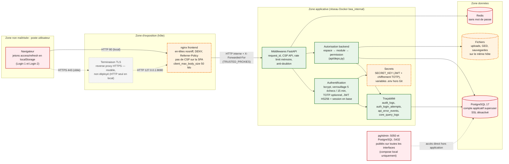

# Architecture de sécurité — BEA DIGITAL

> Audit documentaire du 22/10/2026, en lecture seule. Aucun test d'intrusion, aucun scan, aucune
> modification de contrôle. Ce document **ne constitue pas** une attestation de conformité à une
> norme ou à une réglementation. Aucune valeur de secret n'y figure : seules la présence ou
> l'absence de variables ont été contrôlées.

## 1. Frontières de confiance

Source éditable : [diagrams/05-securite.mmd](diagrams/05-securite.mmd).

*Légende : vert = contrôle implémenté ; orange = contrôle partiel ; gris = prévu, non déployé ;
rouge = point d'exposition identifié. Pointillés = flux cible ou hors application.*

## 2. Authentification et sessions

| Élément | Implémentation constatée | Preuve |
|---|---|---|
| Deux niveaux de session | **Login 1** (plateforme, `kind=platform`) et **Login 2** (module, `kind=module`, rattachée à une session Login 1 parente). Un jeton Login 2 n'ouvre que son module ; un jeton Login 1 est refusé sur les routes métier protégées par `require_module_access` | `backend/app/api/deps.py`, `backend/app/models/auth.py` |
| Jetons | JWT HS256 signés avec `SECRET_KEY` (`python-jose` 3.3.0), claims `sub`, `exp`, `type`, `sid`, `jti` ; pas d'`iss` ni d'`aud` | `backend/app/core/security.py` |
| Révocation | **Chaque requête** vérifie que la session (`sid`) est active en base (`auth_sessions.revoked_at`, `expires_at`) : la révocation est immédiate. Révocation par jeton, par session, par module et pour tout un utilisateur ; écran CORE ADMIN Sessions | `services/auth_session_service.py` |
| Rafraîchissement | Rotation du refresh token à chaque usage (`refresh_jti` unique) ; un refresh rejoué est refusé, sans révoquer la session. L'expiration de la session est repoussée à chaque rafraîchissement | `rotate_refresh` |
| Durées | Access : 15 min par défaut (30 min dans la configuration locale et dans le modèle de production). Refresh Login 1 : 1 jour par défaut (7 jours localement). Session module : 45 min | `core/config.py`, `.env.docker` (valeurs non secrètes), `deployment/env.production.example` |
| Mots de passe | bcrypt ; politique serveur (10 caractères, majuscule, minuscule, chiffre, spécial) ; historique (`password_history`) | `core/password_policy.py`, `docs/securite-bea-digital.md` |
| Verrouillage | 5 échecs dans une fenêtre de 15 min (`auth_login_attempts`) ; échecs audités | `auth.py`, politique locale lue en base |
| Réinitialisation | Routes publiques `forgot-password` / `reset-password` **désactivées** (403) ; réinitialisation par un administrateur CORE ADMIN | `auth.py` l. 235-272 |
| MFA (TOTP) | Implémenté (pyotp), secret chiffré au repos (Fernet dérivé de `SECRET_KEY`). **Optionnel** pour tous ; exigible pour CORE ADMIN via `MFA_REQUIRED_FOR_CORE_ADMIN`. Instance locale : exigence **désactivée**, aucun utilisateur actif avec TOTP activé ; modèle de production : `true` | `core/secret_box.py`, `require_platform_permission`, requête agrégée en base locale |
| Stockage côté client | Jetons d'accès et de rafraîchissement dans `localStorage` (lisibles par tout script exécuté sur la page) | `core/services/auth.service.ts` |
| Inactivité | Délai d'inactivité de 2 min mentionné dans un commentaire ; **aucune implémentation retrouvée** côté interface | `core/config.py` (commentaire), recherche dans `src/` |

## 3. Autorisations (RBAC)

- **Modèle** : `users` → `user_roles` → `roles` → `role_permissions` → `permissions` ; accès aux
  espaces (`user_espace_acces`) et aux modules (`user_module_acces`). Instance locale : 60 rôles,
  243 permissions (`mg` 83, `core` 47, `reclamations` 28, `clientele` 23, `eer` 22, `formation` 16,
  `immobilisations` 12, …).
- **Convention** : permission `{module}.{action}` ; `{module}.admin` couvre `{module}.*` ; `*` et
  `is_superuser` donnent tout.
- **Contrôle backend** : toutes les routes métier passent par `require_module_access(code)` au niveau
  du routeur (EER, Formation, Clientèle, Réclamations, Immobilisations) ou dans chaque route
  (Moyens Généraux : 83 `require_permission` dans `mg_stock.py`, 78 dans `mg_achats.py`…). Le
  module doit être `actif` et accordé à l'utilisateur.
- **Contrôles complémentaires** dans les services : périmètre, propriétaire (`require_owner`),
  agence, état métier. Le Studio les classe « non déterminés » par prudence (383 opérations au
  21/10/2026).
- **Frontend** : gardes et masquage de menus = confort uniquement.
- **RLS PostgreSQL** : non activée ; le backend est le seul point de contrôle.

## 4. Pouvoirs d'administration sensibles

| Fonction | Ce qu'elle permet | Garde-fous constatés | Point d'attention |
|---|---|---|---|
| CORE QUERY — mode standard | `SELECT` en lecture seule depuis le navigateur | Validateur SQL, liste blanche de fonctions, colonnes secrètes refusées, rôle `bea_core_query_reader`, `READ ONLY`, délais, journal `core_query_logs` + audit | Les données personnelles des tables métier restent interrogeables par les détenteurs de la permission |
| CORE QUERY — mode administrateur (`core.admin.query.admin`) | **SQL libre en écriture** : `INSERT`/`UPDATE`/`DELETE`, DDL (`CREATE`, `ALTER`, `DROP`, `TRUNCATE`), lecture des colonnes secrètes | Motif obligatoire, confirmation, simulation, audit avec SQL tronqué | Exécuté avec le compte applicatif **superuser** : capacité équivalente à un accès DBA depuis le navigateur |
| Sauvegardes / restauration CORE ADMIN | `pg_dump`, téléchargement d'un dump, **restauration** depuis l'interface | Permissions dédiées, sauvegarde de sécurité avant restauration, audit | Un dump téléchargé contient l'intégralité des données (dont hachages et données clients) |
| pgAdmin (local) | Administration complète de la base | Compte pgAdmin | Publié sur `0.0.0.0:5050` en local ; absent du compose de production |

## 5. Protection des échanges et du réseau

| Contrôle | Local (constaté) | TEST / PROD (déclaré) |
|---|---|---|
| HTTPS | Non : HTTP sur le port 80 | Modèle nginx hôte TLS 1.2/1.3 + HSTS, à adapter par l'IT. Non déployé |
| Ports publiés | `0.0.0.0:80` (frontend), `0.0.0.0:5432` (PostgreSQL), `0.0.0.0:5050` (pgAdmin) — constaté par `docker ps` | Uniquement `127.0.0.1:8080` (frontend) ; PostgreSQL et Redis non publiés |
| Chiffrement vers PostgreSQL | `DATABASE_SSL=false` (réseau Docker interne) | `DATABASE_SSL=false` par défaut |
| Redis | Pas d'authentification ; non publié | Idem ; persistance désactivée |
| CORS | Liste `CORS_ORIGINS` ; expression régulière localhost en `development` uniquement | Domaine BEA à renseigner |
| En-têtes | nginx : `nosniff`, `DENY`, `Referrer-Policy`, `Permissions-Policy`. API : + CSP stricte, HSTS hors développement. **SPA servie sans CSP** | Idem + HSTS au reverse proxy |
| IP cliente | `X-Forwarded-For` lu uniquement depuis les proxys déclarés (`TRUSTED_PROXIES`) | Adresse du reverse proxy hôte à renseigner, sinon tous les agents partagent la même IP vue (rate limit commun) |
| Pare-feu, VLAN, VPN | Non vérifiable | Inventaire vide (`docs/deployment/00-inventaire-bea.md`) |

## 6. Limitation de débit et anti-doublon

- **Rate limiting** : fenêtre glissante d'une minute, **en mémoire du processus** (perdue au
  redémarrage, non partagée entre instances). Catégories : Login 20/min, réinitialisation 10/min,
  routes sensibles 60/min, API 300/min, par IP. Activé dans la politique locale.
- **Idempotence** : en-tête `Idempotency-Key` envoyé par le front ; Redis ; si Redis est
  indisponible, la protection est levée sans bloquer (dégradation journalisée).
- **Quotas Studio** : Redis, refus si Redis indisponible (fail-closed).

## 7. Fichiers et documents

- Extensions autorisées (PDF, Word, Excel, images), contrôle de la signature binaire, refus des
  documents à macros, 25 Mo maximum (`backend/app/core/fichiers.py`).
- Antivirus clamd : code présent et fail-closed **si** `CLAMAV_HOST` est renseigné ; **non
  configuré** dans l'environnement local ni dans le modèle de production (valeur vide).
- Fichiers stockés sur le disque de l'hôte (`storage/uploads`, `storage/ged`), non servis en statique,
  téléchargés via l'API authentifiée. Aucun chiffrement applicatif des fichiers au repos.

## 8. Journalisation et audit

| Journal | Contenu | Constat |
|---|---|---|
| `audit_logs` | Utilisateur, action, entité, avant / après (JSONB), IP, espace, module, session, `request_id` | Implémenté et appelé dans les endpoints (connexions, échecs, exports, actions métier) |
| `auth_login_attempts` | Tentatives de connexion | Implémenté |
| `api_error_events` | Erreurs HTTP ≥ 400 avec `request_id`, route, utilisateur, durée ; purge planifiée ; alerte sur pic de 5xx | Implémenté |
| `core_query_logs` | Requêtes CORE QUERY | Implémenté |
| Journal d'accès JSON `bea.access` | Requêtes, statut, durée | **Non émis au niveau INFO** (aucune configuration de logging) ; seules les lignes WARNING/ERROR sortent |
| Journal Uvicorn | Ligne par requête avec chemin **et chaîne de requête** | Seul journal d'accès effectif ; peut contenir des paramètres de recherche |
| Journaux Docker | `json-file` 5 × 20 Mo en TEST/PROD ; illimité en local | Aucune centralisation (SIEM) déclarée |

Intégrité des journaux : `audit_logs` est une table ordinaire, modifiable par le compte applicatif
(et via le mode administrateur de CORE QUERY). Pas de scellement ni d'export externe constaté.

## 9. Secrets et configuration

- Fichiers `.env`, `.env.docker`, `backend/.env.docker` présents localement et **ignorés par Git**
  (`git check-ignore` vérifié). Le scan CI basique refuse aussi leur présence dans le dépôt.
- `SECRET_KEY` unique : signature des JWT **et** clé de chiffrement des secrets TOTP (dérivation
  SHA-256). Sa rotation invalide toutes les sessions et rend illisibles les secrets TOTP chiffrés.
- Valeur par défaut `change-me` dans le code ; détectée et signalée « à changer » par le contrôle
  CORE ADMIN, **mais le démarrage n'est pas bloqué**.
- Pas de coffre-fort de secrets ; secrets de production prévus dans `.env.production` (droits 600)
  et variables GitLab.
- Mot de passe PostgreSQL injecté dans le conteneur pgAdmin (`pgpass`) en local.

## 10. Sauvegarde et restauration

| Mécanisme | Statut |
|---|---|
| Sauvegardes CORE ADMIN (global / département / module) via `pg_dump` | Implémenté ; 201 fichiers dans `backups/` localement (31/07 → 22/10/2026, ~616 Mo), **sur le même disque** que la base |
| Sauvegarde vérifiée avant déploiement (`backup-pre-deploy.sh` : taille, `pg_restore --list`, empreintes, purge 30 j) | Implémenté ; testé sur serveur simulé selon `docs/deployment/08-…md` |
| Sauvegarde nocturne (cron) | Proposée dans la documentation ; non installée (aucun serveur) |
| Copie hors serveur, rétention, chiffrement des sauvegardes | **Non identifiés** — à définir par la DSI |
| Restauration | Scripts `restore.sh`, `db-restore.*` et écran Recovery ; tests de restauration réelle non constatés par l'audit |

## 11. Dépendances et vulnérabilités

- Dépendances Python épinglées en version exacte ; dépendances npm en plages `^` avec
  `package-lock.json`.
- `python-jose` 3.3.0 : bibliothèque peu maintenue, CVE-2024-33663 et CVE-2024-33664 référencées
  par la documentation du projet ; le code restreint l'algorithme accepté.
- Images Docker non épinglées par empreinte ; `dpage/pgadmin4` sans tag.
- Pas d'analyse de vulnérabilités automatisée (pas de `pip-audit`, `npm audit`, scan d'images) dans
  les pipelines ; seul un scan de secrets basique (motifs) existe dans `.gitlab-ci.yml`.

## 12. Synthèse des contrôles par statut

| Contrôle | Statut |
|---|---|
| Sessions Login 1 / Login 2 avec révocation serveur à chaque requête | Implémenté et vérifié (code lu ; instance en service) |
| RBAC backend espace → module → permission | Implémenté et vérifié (code lu) ; efficacité par route non testée par l'audit |
| Hachage bcrypt, politique de mot de passe, verrouillage | Implémenté, non vérifié en exécution |
| Désactivation du reset public | Implémenté et vérifié (code) |
| MFA TOTP | Partiellement implémenté : disponible, non imposé localement, aucun utilisateur actif enrôlé |
| En-têtes de sécurité | Partiel : API complète ; SPA sans CSP (vérifié) |
| Rate limiting | Partiel : en mémoire d'un seul processus |
| Audit applicatif | Implémenté, non vérifié en exécution ; pas de protection d'intégrité |
| Journal d'accès structuré | Partiel : JSON INFO non émis (vérifié) |
| Validation des fichiers | Implémenté ; antivirus non configuré |
| HTTPS / TLS | Absent en local ; modèle seulement pour TEST/PROD — à valider avec la DSI |
| Compte base non superuser | Absent (superuser constaté localement) |
| Chiffrement base / fichiers / sauvegardes au repos | Non identifié |
| Sauvegarde externalisée | Non identifiée — à valider avec la DSI |
| Scan de vulnérabilités | Absent |
| Supervision / SIEM | Absent ou non identifié |
| Authentification machine-à-machine | Absente (volontairement) — décision DSI attendue |
