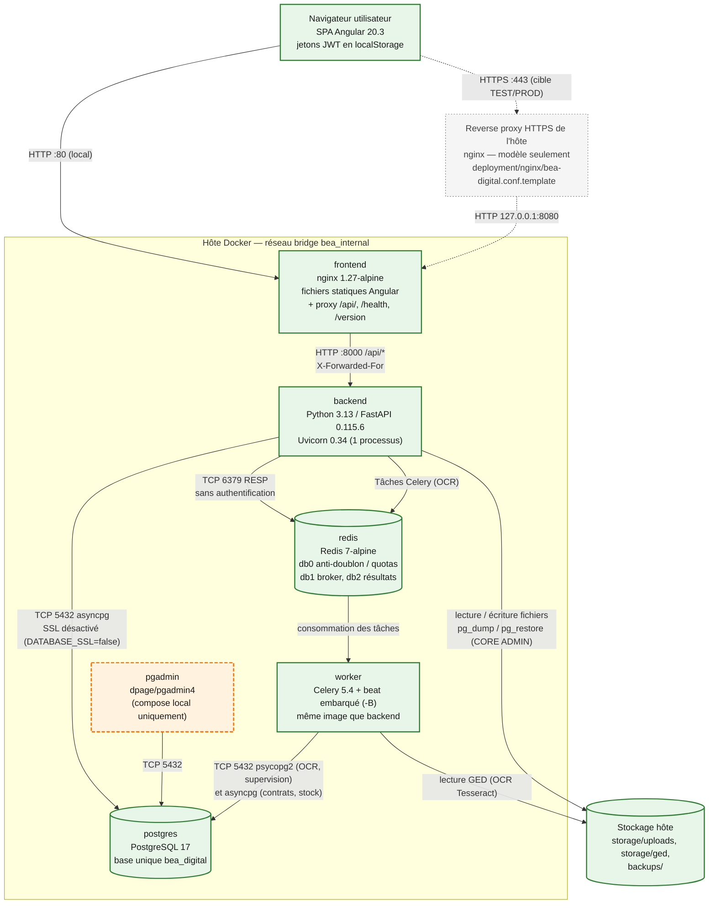
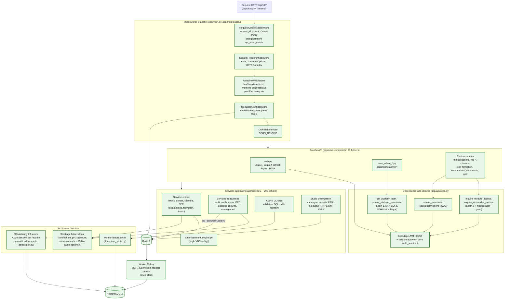

# Architecture technique — BEA DIGITAL

> Audit du 22/10/2026, branche `main`, commit `11c8122` **plus** les modifications non commitées
> présentes dans l'arbre de travail (chantier Stock / notifications). Conventions de statut :
> [README.md](README.md#conventions-de-statut).

## 1. Vue d'ensemble des conteneurs

Source éditable : [diagrams/02-conteneurs.mmd](diagrams/02-conteneurs.mmd).

*Légende : vert = constaté (configuration + conteneur en fonctionnement localement) ; orange
pointillé = présent mais non retenu pour TEST/PROD ; gris = modèle non déployé. Trait plein = flux
constaté ; pointillé = flux cible ou conditionnel.*

### Liaisons

| De → vers | Protocole | Rôle | Données | Mode | Contrôles constatés |
|---|---|---|---|---|---|
| Navigateur → `frontend` | HTTP :80 (local). HTTPS prévu en TEST/PROD via le reverse proxy hôte, non déployé | Chargement de la SPA, appels API | HTML/JS, JSON métier, fichiers | Synchrone | En-têtes `nosniff`, `X-Frame-Options: DENY`, `Referrer-Policy`, `Permissions-Policy` (`frontend/nginx.conf`). Pas de CSP sur la SPA (vérifié par `curl -I`) |
| `frontend` → `backend` | HTTP interne :8000 (`proxy_pass` vers `backend:8000`) | Proxy `/api/`, `/health`, `/version` | JSON, multipart | Synchrone ; délai 120 s, 600 s pour `/api/v1/clientele/` | `X-Forwarded-For` relu seulement si l'émetteur figure dans `TRUSTED_PROXIES` (`backend/app/core/request_client.py`) |
| `backend` → `postgres` | TCP 5432, asyncpg (SQLAlchemy async) | Persistance | Toutes données métier et techniques | Synchrone (async I/O) | Compte unique `POSTGRES_USER` (superuser, constaté localement : `rolsuper = t`). `DATABASE_SSL=false` dans les deux compose |
| `backend` → `redis` | TCP 6379 | Idempotence (db0), file Celery (db1), résultats (db2), quotas Studio | Empreintes de requêtes, réponses JSON ≤ 512 Kio pendant 10 min, messages de tâches | Asynchrone pour Celery | Aucun mot de passe Redis ; isolement par réseau Docker uniquement |
| `worker` → `postgres` | TCP 5432 (psycopg2 synchrone pour OCR / supervision ; asyncpg pour contrats / stock) | Écriture résultats OCR, notifications, alertes | Texte OCR, notifications | Asynchrone (tâches) | Même compte que l'API. Le moteur synchrone (`db/sync_session.py`) ne transmet pas de contexte SSL |
| `backend` / `worker` → fichiers | Système de fichiers (bind mounts) | Pièces jointes, GED, sauvegardes | Documents métier, dumps | Synchrone | Validation des pièces (`core/fichiers.py`) ; aucune exposition statique par nginx |
| `pgadmin` → `postgres` | TCP 5432 | Administration de la base | Toutes données | Interactif | Compte pgAdmin défini par variables ; pgAdmin publié sur `0.0.0.0:5050` en local |

## 2. Table de référence des technologies

Les versions « déclarées » viennent des fichiers de dépendances ; les versions « constatées » ont été
lues dans les conteneurs ou `node_modules` le 22/10/2026 (lecture seule).

| Couche | Technologie | Version constatée | Rôle | Statut de vérification |
|---|---|---|---|---|
| Frontend | Angular (`@angular/core`) | 20.3.26 installée (déclarée `^20.3.0`) | Application monopage unique | Vérifié (`node_modules`, image `bea-frontend` en service) |
| Frontend | Angular CLI / `@angular/build` | 20.3.32 | Build (`application` builder, budgets 2,6 Mo) | Vérifié (fichiers) ; build non relancé par l'audit |
| Frontend | TypeScript | 5.9.3 | Langage | Vérifié (`node_modules`) |
| Frontend | RxJS | 7.8.2 | Flux HTTP, intercepteurs | Vérifié |
| Frontend | Angular Material / CDK | 20.2.14 | Composants UI des modules métier (182 fichiers ; aucun dans `src/app/plateforme/`) | Vérifié (imports) |
| Frontend | Tailwind CSS | 4.3.3 (devDependency) | Feuilles de style (1 référence) | Usage marginal constaté |
| Frontend | `@ngx-translate/core` | 18.0.0 | Déclarée mais **aucun import** dans `src/` | Dépendance inutilisée |
| Proxy / statique | nginx | 1.27.5 (`nginx:1.27-alpine`) | Sert la SPA, proxifie l'API | Vérifié (conteneur) |
| Proxy TLS | nginx hôte | Non déployé | Terminaison HTTPS TEST/PROD | Modèle seulement (`deployment/nginx/`) |
| Backend | Python | 3.13.17 (`python:3.13-slim`) | Langage serveur | Vérifié (conteneur) |
| Backend | FastAPI | 0.115.6 | Framework API | Vérifié (conteneur) |
| Backend | Uvicorn | 0.34.0 | Serveur ASGI, un seul processus (pas de `--workers`) | Vérifié (Dockerfile, conteneur) |
| Backend | Pydantic / pydantic-settings | 2.10.3 / 2.6.1 | Schémas, configuration | Vérifié (conteneur) |
| Accès données | SQLAlchemy (async) | 2.0.36 | ORM, sessions par requête | Vérifié (conteneur) |
| Accès données | asyncpg | 0.30.0 | Pilote PostgreSQL de l'API | Vérifié (conteneur) |
| Accès données | psycopg2-binary | 2.9.10 | Pilote synchrone (Alembic, worker) | Déclaré |
| Migrations | Alembic | 1.14.0 | 98 révisions dans `backend/alembic/versions/` | Vérifié ; révision locale `20261022_mg_stock_alertes` |
| Base de données | PostgreSQL | 17.11 (local, Alpine, collation `C`) ; `postgres:17` Debian prévu en TEST/PROD | Base unique | Vérifié en local ; TEST/PROD non constaté |
| Cache / broker | Redis | 7.4.11 (`redis:7-alpine`) | Broker Celery, idempotence, quotas | Vérifié (conteneur) |
| Traitements asynchrones | Celery (+ beat embarqué) | 5.4.0 | OCR, supervision, rappels, seuils stock | Vérifié (conteneur sain) ; exécution des tâches non observée |
| Traitements asynchrones | Boucle asyncio dans l'API | — | Échéances EER toutes les 6 h, **seulement si le module `eer` est actif** (il ne l'est pas) | Code lu |
| OCR | Tesseract + pytesseract, poppler/pdf2image | 5.5.0 / 0.3.13 | Extraction texte GED | Vérifié (binaire présent) |
| Documents | openpyxl, xlrd, pdfplumber, reportlab, qrcode, python-barcode, Pillow | 3.1.5, 2.0.1, 0.11.5, 4.2.5, 8.0, 0.15.1, 11.0.0 | Imports Excel, exports PDF/Excel, étiquettes | Déclaré |
| Sécurité | python-jose[cryptography] | 3.3.0 | Signature JWT HS256 | Déclaré ; bibliothèque peu maintenue (voir risques) |
| Sécurité | bcrypt | 4.2.1 | Hachage des mots de passe | Déclaré |
| Sécurité | pyotp | 2.9.0 | TOTP (2FA) | Déclaré |
| Sécurité | cryptography (Fernet) | 50.0.2 (transitive, non épinglée) | Chiffrement des secrets TOTP | Vérifié (conteneur) |
| HTTP sortant | httpx | 0.28.1 | Console Studio (ASGI interne), exécuteur HTTPS de test | Déclaré |
| Administration | pgAdmin (`dpage/pgadmin4`) | Non épinglée (tag implicite `latest`) | Administration base, local | Conteneur en service |
| Conteneurisation | Docker / Docker Compose | Non déclarée dans le dépôt | Exécution de tous les services | Docker Desktop constaté localement |
| Build frontend | Node.js | 22 (`node:22-alpine`) | Build de l'image frontend et CI | Déclaré |
| Tests backend | pytest / pytest-asyncio | 8.3.4 / 0.24.0 | 120 fichiers, 1 159 fonctions de test | Non exécutés par l'audit |
| Tests frontend | Karma 6.4 / Jasmine 5.9 | — | 7 fichiers `*.spec.ts` | Non exécutés par l'audit |
| Qualité | ruff | 0.8.4 | Lint Python | Déclaré ; non lancé |
| CI | GitHub Actions (`.github/workflows/ci.yml`) | — | pytest + import de l'app + build Angular dev | Historique d'exécution non consultable (CLI GitHub non authentifiée) |
| CI/CD | GitLab CI (`.gitlab-ci.yml`) | `docker:27` + dind | validate, test, security, build, publish, deploy manuel | Non actif : le remote est GitHub, aucun tag `v*` |

## 3. Frontend

**Emplacement** : `frontend/angular20/` (une seule application, conformément à `AGENTS.md`).

| Aspect | Constat | Preuve |
|---|---|---|
| Structure | 100 % composants autonomes (aucun `@NgModule`), 261 composants, 160 routes en chargement différé (`loadComponent`) | `src/app/app.routes.ts` (540 lignes), `src/app/plateforme/plateforme.routes.ts` |
| Organisation | Un dossier par module métier (`stock-fournitures/`, `clientele/`, `reclamations/`, …), un dossier `plateforme/` (accueil, hubs d'espaces, CORE ADMIN), un dossier `core/` (auth, intercepteurs, feedback, référentiel org) | Arborescence `src/app/` |
| Appels HTTP | `ApiService` + `HttpClient` avec trois intercepteurs dans cet ordre : `httpFeedbackInterceptor`, `idempotencyInterceptor`, `authInterceptor` | `src/app/app.config.ts` |
| URL de l'API | Relative `/api/v1` dans les deux environnements : le front ne connaît aucune adresse de serveur | `src/environments/environment*.ts` |
| Authentification | Deux paires de jetons (plateforme, module) stockées dans `localStorage` ; rafraîchissement mutualisé ; un 401 module renvoie vers `/modules/{code}/acces`, jamais vers Login 1 | `core/services/auth.service.ts`, `core/interceptors/auth.interceptor.ts` |
| Navigation et droits | `authGuard`, `guestGuard`, `moduleGuard(code)`, `coreAdminGuard` (permission `core.admin.access`). Ces gardes sont du confort d'affichage : les contrôles réels sont côté serveur | `core/guards/auth.guard.ts` |
| Contrat de routes | Immobilisations = segments racine figés ; tout autre module = `/{code}/...` | `plateforme/module-routing.contract.ts`, `docs/frontend-plateforme.md` |
| Erreurs | `FeedbackService`, `UiDialogService`, `unsavedChangesGuard`, affichage du `request_id` | `core/feedback/`, `docs/feedback-bea-digital.md` |
| Inactivité | Le commentaire de configuration backend mentionne un délai d'inactivité de 2 min côté interface ; **aucune implémentation retrouvée** dans `src/` | Recherche infructueuse (`idle`, `inactiv`, `mousemove`) |
| Build | `ng build --configuration=production` dans l'image ; budgets 2,6 Mo (initial) et 20 ko (styles de composant) | `frontend/Dockerfile`, `angular.json` |
| Tests | 7 fichiers de spécification (6 sur le Studio d'intégration, 1 sur les alertes stock). La CI ne lance que le build | `src/**/*.spec.ts`, `.github/workflows/ci.yml` |

## 4. Backend

**Emplacement canonique** : `backend/` (les dossiers `app/` et `alembic/` à la racine sont une dette
signalée par `AGENTS.md` : 103 fichiers Python et 13 révisions non déployés).

| Aspect | Constat | Preuve |
|---|---|---|
| Point d'entrée | `create_app()` : middlewares, gestionnaires d'erreurs, routeur `/api/v1`, `/health`, `/health/ready` (base + Redis), `/version` | `backend/app/main.py` |
| Démarrage | `docker-entrypoint.py` lance `alembic upgrade head` sauf si `SKIP_MIGRATIONS=1` (valeur par défaut des deux compose), puis Uvicorn | `backend/docker-entrypoint.py`, `backend/Dockerfile` |
| Routes | 43 fichiers d'endpoints ; environ 1 030 décorateurs de route comptés au 22/10/2026 (le catalogue du Studio en recensait 986 au 21/10/2026) | `backend/app/api/v1/router.py` |
| Dépendances de sécurité | `get_current_user`, `get_platform_user`, `require_module_access`, `require_demandes_module`, `require_permission`, `require_platform_permission` | `backend/app/api/deps.py` |
| Services | ~196 fichiers dans `services/` (dont sous-paquets `clientele/`, `eer/`, `reclamations/`, `integrations/`, `core_query/`) | Arborescence |
| Modèles / schémas | 28 fichiers de modèles (205 classes mappées + 4 tables d'association), 29 fichiers de schémas Pydantic | `backend/app/models/`, `backend/app/schemas/` |
| Accès aux données | Pas de couche « repository » généralisée (`repositories/base.py` seul) : les services utilisent directement `AsyncSession`. Une session par requête, `commit` automatique en fin de requête, `rollback` sur exception | `backend/app/db/session.py` |
| Lecture seule garantie | Moteur dédié (transactions `READ ONLY`, filtre SQL, refus de `flush`) pour simulations et rapports | `backend/app/db/lecture_seule.py` |
| Middlewares | Contexte de requête, en-têtes de sécurité, limitation de débit en mémoire, idempotence Redis, CORS | `backend/app/middleware/` |
| Erreurs | Format standard avec `code`, `message`, `request_id` ; erreurs ≥ 400 enregistrées dans `api_error_events` (purge planifiée) | `backend/app/core/api_errors.py`, `services/api_error_recorder.py` |
| Journalisation | Journal d'accès JSON prévu (`bea.access`) mais **aucune configuration de logging** : seuls les messages WARNING et au-delà sortent. Sur 3 h de journaux locaux : 0 ligne JSON INFO, 26 WARNING, 1 824 lignes d'accès Uvicorn (qui incluent les chaînes de requête) | Absence de `basicConfig`/`dictConfig` ; comptage `docker logs` |
| Tâches planifiées (Celery beat) | Purge `api_error_events` (02:30), pic d'erreurs 5xx (5 min), rappels contrats (07:30), seuils stock (07:00) | `backend/app/workers/celery_app.py`, `tasks_stock.py` |
| Tâches à la demande | OCR des documents GED (`ocr_document.delay`) ; échec d'enfilement non bloquant | `services/document_ingest_service.py` |
| Fichiers | Extensions autorisées, signature binaire vérifiée, macros Office refusées, 25 Mo maximum, antivirus clamd si configuré (fail-closed) | `backend/app/core/fichiers.py` |
| Documentation OpenAPI | `/docs` et `/redoc` désactivés hors développement (`APP_ENV=production` localement) et non proxifiés par nginx | `main.py`, `frontend/nginx.conf` |

## 5. Base de données

| Aspect | Constat | Preuve |
|---|---|---|
| Moteur | PostgreSQL 17 : `postgres:17-alpine` en local (17.11 constaté), `postgres:17` Debian en TEST/PROD (tag mineur non figé) | `docker-compose.yml`, `deployment/docker-compose.prod.yml` |
| Base | Une seule base `bea_digital` pour la plateforme et tous les modules | `AGENTS.md`, `docs/base-de-donnees-unique.md` |
| Volume | Volume nommé `bea_postgres_data` ; interdiction documentée de `docker compose down -v` | Compose |
| Taille du schéma | 210 tables en base locale (205 classes + 4 associations dans le code) | Requête `information_schema` (lecture seule) |
| Migrations | 98 révisions Alembic dans `backend/alembic/versions/`, du 23/07/2026 au 22/10/2026. La première révision modifie des tables existantes : jamais d'Alembic sur base vide | `docs/runbook-migrations.md` |
| Déclaration de retour arrière | `retour_arriere = "compatible" / "restauration"` exigé après `20261020_clientele_14` (5 révisions concernées) ; les antérieures comptent comme `restauration` | `backend/scripts/migrations_retour.py`, `docs/deployment/08-livraison-et-mises-a-jour.md` |
| Initialisation | Restauration d'un dump (`scripts/db-restore.*`, `deployment/scripts/restore.sh`). Le seed (`init_db.py`, `seed_data.py`) est réservé aux bases jetables de test | `AGENTS.md` |
| Collation | `C` en local (Alpine/musl) ; alignement sur le dump attendu en TEST/PROD | Commentaires compose |
| Rôle restreint | `bea_core_query_reader` (NOLOGIN) créé par l'application pour CORE QUERY | `docs/core-query.md` |
| RLS | Non activée ; documentée comme impossible tant que le compte applicatif est superuser | `docs/conformite/README.md` |

Détail des domaines de données : [architecture-donnees.md](architecture-donnees.md).

## 6. Composants du backend

Source éditable : [diagrams/03-composants-backend.mmd](diagrams/03-composants-backend.mmd).

*Légende : tous les composants représentés existent dans le code (vert). Les middlewares sont
listés dans leur ordre d'exécution sur la requête entrante (le dernier ajouté s'exécute en premier).*

## 7. Tests et qualité

| Élément | Constat | Statut |
|---|---|---|
| Tests backend | 120 fichiers, 1 159 fonctions. Les plus fournis : clientèle (23 fichiers), Moyens Généraux (19), CORE (12), EER (8), réclamations (8), intégrations (5) | **Non exécutés** par cet audit |
| Garde de base | Les tests qui créent des comptes s'ignorent sur la base `bea_digital` (fixture `base_jetable`) | `backend/tests/conftest.py` |
| Dernier résultat documenté | « Suite complète : 5 échecs, identiques avec le code HEAD, dépendants des données copiées » | `docs/studio-integration-api.md` § 11.7 (déclaratif) |
| Tests frontend | 7 spécifications Karma ; pas d'exécution en CI | Non exécutés |
| Couverture | `karma-coverage` installé ; aucun rapport de couverture versionné ni produit en CI ; pas d'outil de couverture Python | Non mesurée |
| CI | Les jobs GitHub et GitLab n'instancient **aucun service PostgreSQL** : les tests dépendant de la base sont vraisemblablement ignorés ou en échec en CI | Résultat CI non consultable |
