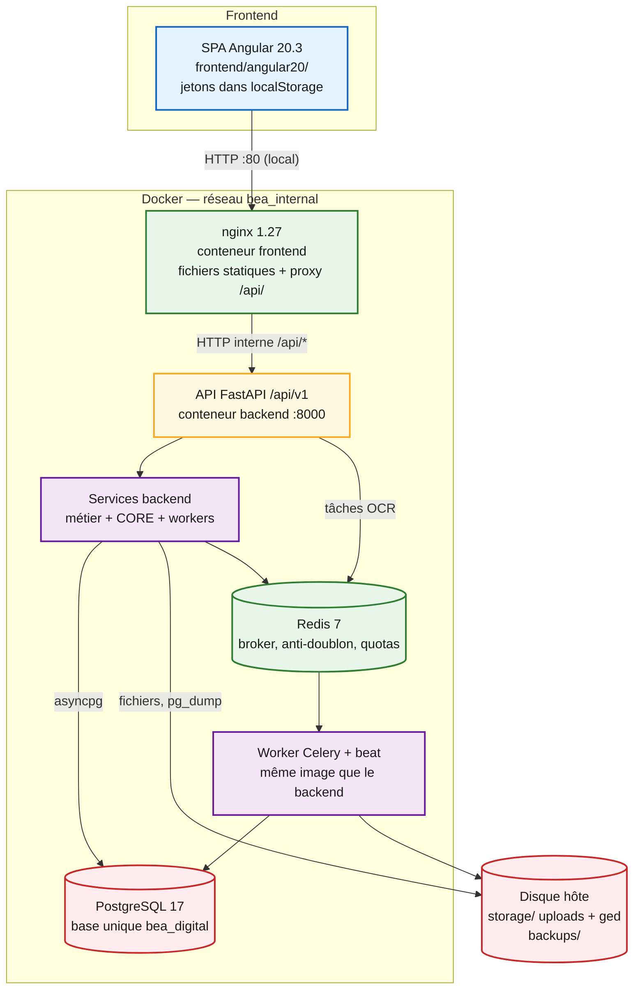

# Couches techniques — Frontend, API, Backend, Docker, Base

> Fiche de lecture rapide pour le DSI. Détail et versions :
> [architecture-technique.md](architecture-technique.md).
> Audit du 22/10/2026 ; le chantier Stock (alertes de seuil) et le cloisonnement des
> notifications font partie du code livré avec ce dossier.

Source éditable : [diagrams/09-couches.mmd](diagrams/09-couches.mmd).



*Légende : bleu = Frontend ; jaune = API ; violet = Backend applicatif ; vert = Docker / Redis ;
rouge = données persistantes.*

## 1. Frontend

| | |
|---|---|
| Emplacement | `frontend/angular20/` — **une seule** application Angular |
| Version | Angular 20.3.26, TypeScript 5.9.3 |
| Organisation | Composants autonomes, routes en chargement différé, un dossier par module + `plateforme/` + `core/` |
| Appels | `HttpClient` vers l’URL relative `/api/v1` (aucun nom d’hôte dans le front) |
| Auth | Deux paires de jetons (Login 1 / Login 2) en `localStorage` ; intercepteur de rafraîchissement |
| Build | Image Docker : `ng build --configuration=production`, servie par nginx |
| Tests | 7 spécifications Karma (Studio + alertes stock) — non exécutées par l’audit d’architecture |

## 2. API

| | |
|---|---|
| Préfixe | `/api/v1` (figé) + `/health`, `/health/ready`, `/version` |
| Cadre | FastAPI 0.115.6, Uvicorn 0.34, un seul processus |
| Routeurs | 43 fichiers dans `backend/app/api/v1/endpoints/` |
| Contrôles | JWT + session en base, puis `require_module_access` / `require_permission` |
| Format d’erreur | `code`, `message`, `request_id` |
| Docs OpenAPI | `/docs` désactivé lorsque `APP_ENV=production` ; non proxifié par nginx |

Exemples de préfixes : `/auth`, `/plateforme/admin`, `/mg/stock`, `/mg/achats`, `/clientele`,
`/eer`, `/formation`, `/reclamations`, `/documents`, `/ged`.

## 3. Backend

| | |
|---|---|
| Emplacement canonique | `backend/` (`app/` et `alembic/` à la racine = dette, non déployés) |
| Langage | Python 3.13.17 |
| Couches | endpoints → `api/deps.py` → `services/` (~200 fichiers) → SQLAlchemy / fichiers |
| Tâches | Worker Celery (OCR, supervision, rappels contrats, **seuils stock**) ; boucle EER dans l’API si le module est actif (il ne l’est pas) |
| Fichiers | `core/fichiers.py` : signature, macros refusées, 25 Mo ; ClamAV si configuré |

## 4. Docker

| Service | Image | Rôle | Ports locaux | Ports TEST/PROD (déclarés) |
|---|---|---|---|---|
| `frontend` | `bea-digital-frontend` (nginx 1.27-alpine) | SPA + proxy API | `0.0.0.0:80` | `127.0.0.1:8080` |
| `backend` | `bea-digital-backend` (python:3.13-slim) | API | interne `:8000` | interne |
| `worker` | même image | Celery + beat | — | — |
| `postgres` | `postgres:17-alpine` local / `postgres:17` Debian prévu | Base | `0.0.0.0:5432` | non publié |
| `redis` | `redis:7-alpine` | Broker / cache | interne | interne, sans persistance |
| `pgadmin` | `dpage/pgadmin4` | Admin base | `0.0.0.0:5050` | **absent** |

Compose : `docker-compose.yml` (local), `deployment/docker-compose.prod.yml` (cible).
Réseau unique `bea_internal`. Interdit : `docker compose down -v`.

## 5. Base de données

| | |
|---|---|
| Moteur | PostgreSQL 17, base unique `bea_digital` |
| Accès API | SQLAlchemy 2.0 async + asyncpg ; worker OCR en psycopg2 synchrone |
| Schéma | 210 tables (préfixes `mg_`, `clientele_`, `eer_`, `integration_`, …) |
| Migrations | Alembic, 98+ révisions dans `backend/alembic/versions/` ; jamais sur base vide |
| Révisions Stock / notifications | `20261022_notifications_01` puis `20261022_mg_stock_alertes` (`retour_arriere = compatible`) |
| Volume | `bea_postgres_data` |
| Compte local | Superuser (à changer avant TEST/PROD) |
| SSL | `DATABASE_SSL=false` (réseau Docker interne) |

## 6. Le reste

| Couche | Rôle | État |
|---|---|---|
| Redis | File Celery, anti-doublon, quotas Studio | En service localement, sans mot de passe |
| nginx (conteneur) | SPA + proxy | En service |
| Reverse proxy HTTPS hôte | TLS 1.2/1.3 | Modèle seulement |
| GED / fichiers | `storage/ged`, `storage/uploads` | Bind mounts |
| Sauvegardes | `backups/` + écran CORE ADMIN | Même disque que la base (local) |
| CI | GitHub Actions (tests + build) | Fichier présent |
| CI/CD | GitLab (build, publish, deploy manuel) | Inactif (remote GitHub) |
| SMTP / ClamAV | E-mails, antivirus pièces | Code présent, non configuré |

## 7. Parcours d’une requête métier

```text
Navigateur (Angular)
  → nginx :80  (ou HTTPS hôte → 127.0.0.1:8080 en cible)
    → FastAPI /api/v1/…  (middlewares : request_id, en-têtes, quota, anti-doublon, CORS)
      → JWT + session auth_sessions
        → permission + module actif
          → service
            → PostgreSQL  et/ou  fichiers  et/ou  file Redis (OCR, alertes stock)
```
