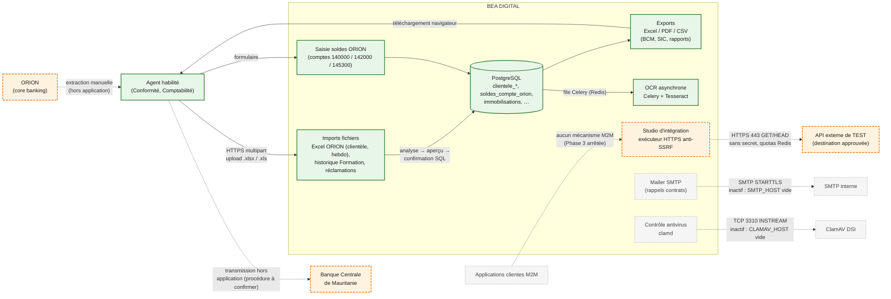

# Flux de données et intégrations — BEA DIGITAL

> Audit du 22/10/2026. **Aucune connexion technique entre BEA DIGITAL et ORION n'existe dans le
> code** : pas de pilote Oracle, ODBC, SOAP, SFTP, LDAP ou file de messages, pas de client HTTP vers
> ORION. Les données ORION entrent par **dépôt manuel de fichiers** par des agents habilités.

## 1. Vue des flux

Source éditable : [diagrams/07-flux-integrations.mmd](diagrams/07-flux-integrations.mmd).

*Légende : vert = flux implémenté dans le code ; orange = système ou flux dont l'usage réel reste à
confirmer ; gris = flux inactif (non configuré) ou futur. Trait plein = échange applicatif actif ;
pointillé = échange manuel, conditionnel ou futur. Le protocole « HTTPS » entre l'agent et BEA
DIGITAL est la cible : l'instance locale fonctionne en HTTP.*

## 2. Classement des intégrations

### 2.1 Implémentées et couvertes par des tests (tests non exécutés par l'audit)

| Intégration | Source → cible | Mécanisme | Données | Contrôles d'accès | Erreurs et reprise | Preuves |
|---|---|---|---|---|---|---|
| Import « État des comptes ORION » (Base Clientèle) | Fichier ORION → `clientele_*` | Upload Excel via `/api/v1/clientele/…` ; analyse, aperçu, confirmation, puis écriture SQL | Clients, comptes, RIB, identifiants, agences | Login 2 `clientele` + `clientele.import.execute` ; audit | Rapport d'anomalies Excel ; import rejouable sans doublon ; un client absent n'est jamais supprimé | `services/clientele/import_service.py`, `docs/conformite/clientele-phase2.md` |
| Import hebdomadaire (lots) | Fichier hebdomadaire → `clientele_*` | `POST /lots/analyse`, `/lots/{id}/integrer` | Mouvements clients | Idem | Rejets téléchargeables, `forcer` si fichier déjà importé | `docs/conformite/README.md` |
| Soldes ORION (comptes non amortissables) | Saisie agent → `soldes_compte_orion` | Formulaire / API reporting | Soldes agrégés de 3 comptes | Login 2 `immobilisations` | Verrouillage par exercice | `services/solde_compte_orion.py` |
| Déclarations BCM / SIC | `clientele_*` → fichiers | Génération Excel/PDF, **téléchargement** par l'utilisateur | Indicateurs réglementaires | Permissions `clientele.*`, audit des exports | Snapshot à la validation | `docs/conformite/bcm-correspondance-champs.md`, `sic-correspondance-champs.md` |
| OCR des documents | `ged_documents` → worker | Celery via Redis ; Tesseract local | Texte extrait | Interne | Reprise automatique, relance manuelle `retry-ocr` | `workers/tasks_ocr.py` |

### 2.2 Présentes dans le code, usage opérationnel à confirmer

| Intégration | Statut | Détail |
|---|---|---|
| Studio — exécution de tests d'API externes | Code et tests présents ; **aucune destination approuvée observée** | HTTPS 443 uniquement, DNS limité aux adresses publiques, IP épinglée, redirections refusées, délais 3 s / 8 s, corps ≤ 64 Kio, quotas Redis, pas de secret (opérations authentifiées refusées). Environnement TEST seulement |
| Envoi d'e-mails (rappels contrats) | Code présent ; **inactif** (`SMTP_HOST` vide localement et dans le modèle de production) | SMTP STARTTLS ; notifications in-app comme canal principal |
| Antivirus des pièces jointes | Code présent ; **inactif** (`CLAMAV_HOST` vide) | Protocole clamd INSTREAM, refus si configuré mais injoignable |
| Supabase | Variables `SUPABASE_*` déclarées mais **non utilisées** dans le code ; l'ancien hébergement PostgreSQL Supabase sert de source historique de dump | `docs/SUPABASE.md`, `scripts/backup-from-supabase.ps1` |

### 2.3 Documentées, non implémentées

| Interface | Statut |
|---|---|
| Authentification machine-à-machine (OAuth2 client credentials, mTLS) | Options comparées dans `docs/studio-integration-api.md` § 12 ; **arrêtée** en attente de décision DSI ; module `m2m_preparation.py` non branché |
| Workflow BL / facture / paiement avec ORION | Explicitement hors périmètre (`docs/moyens-generaux/cdc-fonctionnel-v1.md`) |
| Rapprochement avec le classeur externe « FLUX » (EER) | Source absente du dépôt |

### 2.4 Prévues ou à décider

- Intégration directe ORION (lecture des comptes, clients, soldes) : **aucune interface prévue dans le
  dépôt** ; dépend de l'architecture ORION et des interfaces autorisées par la DSI.
- Transmission automatisée des déclarations à la BCM : non prévue.
- Annuaire d'entreprise (LDAP / Active Directory / SSO) : non prévu ; les comptes sont locaux à BEA
  DIGITAL.

## 3. Points à confirmer avec la DSI

1. Architecture réelle d'ORION, éditeur, version, interfaces exposées (API, vues, exports planifiés).
2. Interfaces que la DSI autorise pour BEA DIGITAL (lecture seule, fréquence, volumétrie).
3. Procédure actuelle d'extraction des fichiers ORION : qui extrait, sur quel poste, comment le
   fichier est transporté jusqu'à BEA DIGITAL, contrôle d'intégrité.
4. Réseau : zones, pare-feu, flux autorisés entre le serveur BEA DIGITAL et ORION, SMTP, ClamAV,
   GitLab, registre d'images.
5. Certificats : autorité interne, domaine, renouvellement.
6. Mécanisme d'authentification attendu (comptes locaux, annuaire, SSO, M2M).
7. Règles d'accès et responsabilités : ORION reste maître des données ; BEA DIGITAL maître de ses
   workflows ; qui arbitre un écart entre une copie importée et ORION.
8. Procédure de transmission des déclarations BCM / SIC et validation avant envoi.
