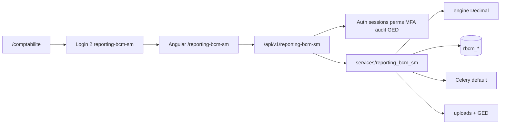

# T2 — Dossier de conception (révisé)

**Module :** Reporting BCM SM — Situation Mensuelle (**Comptabilité**)  
**Distinct de :** BCM Clientèle (`clientele_*`, `clientele.bcm.*`)  
**Version dossier :** 1.1 — 16/11/2026 (corrections A–I)  
**Statut :** conception — pas d’implémentation dans ce document  

Bases : T0 + T1 acceptés ; brief T2 ; conventions code BEA DIGITAL vérifiées.

---

## 1. Architecture générale

Intégration **native** dans BEA DIGITAL (une appli Angular, un backend FastAPI, une PostgreSQL).

| Élément | Valeur |
|---------|--------|
| Code module | `reporting-bcm-sm` |
| Espace | `comptabilite` → `/comptabilite` |
| UI | `/reporting-bcm-sm/...` |
| API | `/api/v1/reporting-bcm-sm/` |
| Tables | `rbcm_*` |
| Backend canonique | `backend/` uniquement |

**Alternative écartée :** réutiliser le placeholder catalogue `reporting-compta` sans clarification — trop ambigu. **Décision produit P1** toujours listée en ouvert si amendement.

---

## 2. Architecture backend

| Composant | Emplacement |
|-----------|-------------|
| Models | `backend/app/models/reporting_bcm_sm.py` |
| Schemas | `backend/app/schemas/reporting_bcm_sm.py` |
| Services | `backend/app/services/reporting_bcm_sm/` |
| Engine | `.../reporting_bcm_sm/engine/` (sans FastAPI) |
| Endpoints | `backend/app/api/v1/endpoints/reporting_bcm_sm.py` |
| Router | `backend/app/api/v1/router.py` |
| Tasks | `backend/app/workers/tasks_reporting_bcm_sm.py` |
| Migrations | `backend/alembic/versions/` |

**Réutiliser :** `require_module_access`, `require_permission`, `record_audit`, `GedService`, `api_errors`, openpyxl, `Numeric`/`Decimal`, Celery queue `default`.  
**Ne pas toucher :** `amortissement_engine.py`, BCM Clientèle, auth/MFA CORE.

---

## 3. Architecture frontend

Pattern modules préfixés (`formation`, `reclamations`) :

- `MODULE_ROUTE_CONTRACTS['reporting-bcm-sm']` : `prefixed`, `entryPath=/reporting-bcm-sm/accueil`, `espacePath=/comptabilite`
- `moduleGuard('reporting-bcm-sm')`
- `FeedbackService`, `UiDialogService`, `unsavedChangesGuard`, pipe `montant`

### Écrans (cible complète ; T3 = sous-ensemble)

Accueil ; campagnes (liste/création/détail) ; imports DET/COND ; rapprochement ; paramètres ; mapping ; ETAT A/B/C ; informations ; FPN/ratios ; contrôles ; décisions ; validation ; livrables ; audit.

T3 livre uniquement : accueil + campagnes + permissions + audit (voir plan T3).

---

## 4. Modèle de données (révisé)

### 4.1 Conventions numériques

- Montants déclaratifs / résultats SM : **`Numeric(18, 2)`** — aligné `immobilisations.valeur_brute` et usages comptables fr-FR à 2 décimales.
- Soldes bruts importés DET : même précision après normalisation ; si la DSI exige conservation de précision source supérieure, **décision ouverte** (ne pas inventer `Numeric(24,6)` sans preuve).
- Jamais `float` / `DOUBLE` en métier.

### 4.2 Campagnes — `rbcm_campaign`

| Colonne | Type | Notes |
|---------|------|-------|
| id | UUID PK | |
| period_year / period_month | INT | CHECK mois 1–12 |
| closing_date | DATE | nullable |
| bank_code | VARCHAR(16) | défaut BEA |
| status | VARCHAR(24) | cycle de vie unique |
| campaign_version | INT | défaut 1 |
| reopened_from_id | UUID FK self | nullable |
| preparer_id, controller_id, approver_id | UUID FK users | |
| mapping_version_id, template_version_id, current_batch_id | UUID FK | nullable en T3 |
| locked_at, approved_at | TIMESTAMPTZ | |
| timestamps | | TimestampMixin |

**Unicité :** `UNIQUE(bank_code, period_year, period_month, campaign_version)` (P2).  
**Réouverture :** nouvelle ligne `campaign_version+1`, `reopened_from_id` renseigné ; ancienne version figée lecture seule.  
**FK historiques :** `ON DELETE RESTRICT`.

**Statuts :** `BROUILLON`, `IMPORTS`, `RAPPROCHEE`, `PARAMETREE`, `CALCULEE`, `A_CONTROLER`, `APPROUVEE`, `CLOTUREE`, `ROUVERTE` (transition).

### 4.3 Imports

`rbcm_import` : `file_type` (`BAL_DET`\|`BAL_COND`), filename, stored_path, **sha256**, size, status, period detect, control_report JSONB, uploaded_by, `supersedes_import_id`.  
**UNIQUE(campaign_id, file_type, sha256)**.  
Import **VALIDATED** ne peut pas être écrasé : nouvel import → `SUPERSEDED` sur l’ancien seulement après validation explicite du nouveau.

`rbcm_import_batch`, `rbcm_import_line_det` (bulk), `rbcm_balance_ncg`, `rbcm_reconcile_issue`.

DET : lecture `read_only` openpyxl + insertion par lots (pas de DataFrame pandas — absent du projet).

### 4.4 Mapping

`rbcm_mapping_version` + `rbcm_mapping_rule` + `rbcm_mapping_rule_source`.

**Cycle de vie règle — un seul champ :** `lifecycle_status` ∈  
`A_VALIDER` \| `ACTIVE` \| `REJECTED` \| `SUPERSEDED`  
(Pas de couple redondant `status` + `active`.)

Champs règle : match EXACT/PREFIX, pattern, exclusions JSONB, **amount_basis**, **signed_balance_mode** (voir §5), sign_multiplier, priority, provenance (`CORRESPONDANCE`\|`CLAUDE`\|`MAQUETTE`\|`ARBITRAGE`), `divergence_group`.

Import initial 115 règles → **`A_VALIDER` uniquement**.

### 4.5 Paramètres

`rbcm_parameter_definition` + `rbcm_parameter_value` : 8 codes T1 ; source ; période ; justification ; auteur ; validation ; **historique append-only** (nouvelle valeur = nouvel enregistrement ou table hist).  
**Pas de reconduction N−1.**

### 4.6 Calculs

`rbcm_calculation_run` : fingerprints (sha imports, mapping_version, params, engine_version, template_version).  
`rbcm_cell_result` : `calculated_value`, `retained_value`, `value_status`, traces JSONB ; UNIQUE(run_id, cell).

### 4.7 Décisions — append-only strict

`rbcm_cell_decision` :

| Colonne | Rôle |
|---------|------|
| id | PK |
| campaign_id, cell_ref | cible |
| calculation_run_id | run d’origine |
| calculated_value | copie figée du calcul |
| decided_value | valeur retenue par la décision |
| decision_type | enum §8 |
| reason | obligatoire si correction / zéro manuel / rejet |
| document_id | GED justificatif |
| created_by_id, created_at | auteur |
| reviewed_by_id, reviewed_at | visa |
| **supersedes_decision_id** | FK vers décision remplacée |

**Interdit :** UPDATE des champs de fond d’une décision validée ; **pas** de `superseded_at` mutatif sur l’ancienne ligne (l’historique se lit par chaînage `supersedes_decision_id`).  
Option : flag dérivé en lecture `is_current = NOT EXISTS (enfant)`.

### 4.8 ECART (par campagne)

Table ou structure run `rbcm_ecart_snapshot` :

- `campaign_id` / `run_id`
- `amount` Numeric(18,2) — **calculé** (ex. Σ (TOTDEB−TOTCRE) classes 1–8 COND de **cette** période)
- `formula_key` / `source_description`
- `is_active_in_run` bool — faux tant que D02 + règle ACTIVE absents
- refs documentaires optionnelles : `historical_ref_2873223`, `historical_ref_2873218` (métadonnées, **pas** injectées comme constantes de calcul)

### 4.9 GED

Réutiliser `ged_documents` : `espace_code=comptabilite`, `module_code=reporting-bcm-sm`, `entity` / `entity_id` = campagne, import, décision.  
SHA fichier aussi sur `rbcm_import`.

### 4.10 Template / livrables / contrôles / validation_event

Inchangés dans l’esprit T2 initial ; template versionné par SHA canevas ; livrables liés au run.

---

## 5. Moteur de calcul — bases de montants (correction A)

Le moteur ne généralise **pas** `MAX(D-C,0)` / `MAX(C-D,0)` à toutes les règles.

| Code | Définition conceptuelle | Usage |
|------|-------------------------|--------|
| **D** | Total débit brut (`TOTDEB` COND ou Σ DET) | amount_basis=`D` |
| **C** | Total crédit brut | amount_basis=`C` |
| **SD** | Solde débiteur **selon mode règle** | voir ci-dessous |
| **SC** | Solde créditeur **selon mode règle** | voir ci-dessous |
| **SIGNED** | Solde signé `D − C` (peut être négatif) | amount_basis=`SIGNED` si une règle le demande |

**Modes SD/SC configurables par règle** (`signed_balance_mode`) :

- `NATURAL` : SD = max(D−C, 0) ; SC = max(C−D, 0) — **uniquement si la règle validée le prescrit**
- `RAW_POSITIVE_LEG` : jambe débitrice/créditrice brute selon D15 (TOTDEB/TOTCRE comme sommes de soldes)
- `CUSTOM` : expression versionnée (rare)

**D15 reste ouverte** : tant qu’elle n’est pas tranchée, les règles D/C sur comptes bi-mouvementés restent en `A_VALIDER` / simulation documentée, pas en vérité prod.

### Ordre de calcul

1. Imports → 2. Contrôles balances → 3. Paramètres → 4. ETAT A → 5. Agrégats (**non écrits** dans Excel) → 6. ETAT B (70/30 si D09 ouvert) → 7. ETAT C (+ alerte double comptage 209, sans modifier canevas) → 8. Informations → 9. FPN → 10. Ratios → 11. Contrôles finaux (moteur Python).

ECART : appliqué seulement si `is_active_in_run` et règle ECART `ACTIVE`.

---

## 6. Décisions humaines (statuts cellule)

| Statut | Entrée | Actions | Rôles | Effet gate |
|--------|--------|---------|-------|------------|
| AUTOMATIQUE | Calcul OK, règle ACTIVE | Confirmer si sensible | Système / préparateur | OK |
| A_CONFIRMER | Sensible | Confirmer / corriger | Préparateur → Contrôleur | Bloque approbation |
| CORRECTION_MANUELLE | Override | Nouvelle décision append-only | Habilités | Trace obligatoire |
| ZERO_CONFIRME | Données établissent 0 | — | Système | OK |
| ZERO_MANUEL | 0 décidé | Motif + visa | Habilités | OK si validé |
| NON_RENSEIGNE | Pas de donnée | Compléter | Préparateur | **Bloque** si obligatoire |
| EN_ATTENTE_DECISION | 67 / D0x | Arbitrage | Comptabilité | **Bloque** |
| BLOQUE_PAR_ECART | Écart / ECART non tranché | Traiter D02 | Comptabilité | **Bloque** cellules liées |

67 rubriques : jamais zéro automatique.

---

## 7. Workflow et sécurité (correction E)

Rôles : **Préparateur**, **Contrôleur**, **Approbateur**.  
Règles : séparation des tâches ; **interdiction auto-approbation** (`approver_id ≠ preparer_id`) ; motif obligatoire rejet/réouverture ; Login 2 + permissions catalogue ; MFA CORE existant seulement.

Permissions : `reporting-bcm-sm.view|prepare|import|parameters.write|mapping.propose|mapping.validate|confirm|correct|control|approve|export|reopen`.

---

## 8. Excel / PDF (correction D)

- **Vérité :** moteur Python.  
- **openpyxl :** cellules `writable` uniquement ; **663 formules préservées** ; pas de recalcul formule ; avertir caches Excel obsolètes ; conseiller « recalcul à l’ouverture » côté Excel.  
- Contrôles réglementaires : **depuis le moteur**, pas depuis cache Excel.  
- **PDF :** hors V1 sans solution DSI.  
- LibreOffice : option DSI future, **pas** d’installation automatique.

---

## 9. Mapping — trois sources (H)

| Source | Rôle |
|--------|------|
| Correspondance SCD | Réf. technique compte→BCM, bases D/C/SD/SC |
| Claude 16/11 | Réf. travail calcul / cellules |
| Maquette RC | Comparative / divergences |

Divergences D01 visibles jusqu’à arbitrage. 115 règles → `A_VALIDER`.

---

## 10. Paramètres (I)

Huit codes T1 ; pas de reconduction ; source/période/justification/auteur/statut/historique.  
`caisse_devises` dérivable DET **si règle validée** ; autres souvent `EN_ATTENTE` sans D04/D05.

---

## 11. Performance / concurrence / stockage

- DET 55k : streaming + Celery ; verrou campagne sur calcul ; UNIQUE sha256 ; idempotence task.  
- Stockage applicatif sous uploads module + GED ; **ne pas** modifier montages prod ; migration `/srv` planifiée (doc déploiement 11) avant volumes importants.

---

## 12. Tests (cible module)

Unitaires moteur (bases configurables, ECART off) ; mapping multi-sources ; rapprochement ; imports ; décisions append-only ; permissions ; workflow ; SM-R01–R22 ; non-régression objectifs octobre **comme références**, pas preuve totale.

Objectifs oct. (canevas) : H81=H147=11 103 655 009 ; I147=0 ; FPN=1 629 590 430 ; ratios ≈ 16,09 % / 26,2 % / 181,44 %.

---

## 13. Risques

Voir [T2_FINAL_VALIDATION.md](T2_FINAL_VALIDATION.md) et [T2_OPEN_DECISIONS.md](T2_OPEN_DECISIONS.md).

---

## 14. Phases d’implémentation

T3 socle → T4 imports → T5 rapprochement → T6 mapping → T7 ETAT A → … → T15 release (inchangé dans l’esprit ; détail T3 dans plan dédié).

---

## 15. Décisions historiques conservées (ne pas effacer)

- ECART référence oct. COND = **2 873 223** ; observation **2 873 218** non prouvée (T1).  
- Impact mapping 128 : 202400 présent (85,68 M) vs 202300 absent.  
- F9 = caisse_devises DET EUR 20 254,50.  
- BCM Clientèle ≠ ce module.
