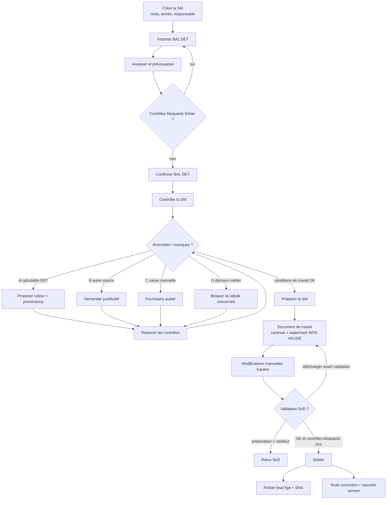

# T3.5 — Conception du workflow métier SM

Branche : `feat/reporting-bcm-sm-t3` · **Aucun commit / push / déploiement.**  
Périmètre : audit + conception. **Pas d’implémentation complète** dans ce livrable.

Vocabulaire UI : **SM = Situation Mensuelle**. Identifiants techniques (`rbcm_campaign`, `/campaigns`) inchangés.

## 1. Décision de lecture des trois Excel

| Fichier | Rôle T3.5 |
|---------|-----------|
| `BEA-SM-10-2026.xlsx` | **Canevas officiel de référence** — c’est le document que le comptable veut obtenir chaque mois. |
| `BAL DET 31-10-2026.xlsx` | **Source unique importée** — 55 192 lignes, 228 NCG, période 31/10/2026. |
| `Copie de Maquette SM-RC-MF.xlsx` | **Aide au mapping** (rubrique → comptes). **Pas** le canevas à générer. |

Le système ne doit **pas** inventer de colonnes, formules ou cellules absentes du canevas.  
L’export actuel (`excel_export.py`) écrit un classeur technique vide de mise en forme BCM : **il n’est pas le livrable**.

---

## 2. Ce que produit réellement le canevas SM (octobre 2026)

Huit feuilles, date d’arrêté `2026-10-31`, banque `BEA` :

| Feuille | Lignes utiles | Contenu métier |
|---------|---------------|----------------|
| `informations à fournir` | 19 | Annexes FPN (créances radiées, bénéfice hors dividendes, actions propres…) |
| `ETAT A` | **157 codes BCM** (101–520) | Situation mensuelle : provisions, MRU résidents / non-résidents, devises résidents / non-résidents, total |
| `ETAT B` | **48 codes** | Concours à l’économie par contrepartie (EPA, EPC, privé, particuliers…) |
| `ETAT C` | **40 codes** | Emplois / ressources / engagements par maturité (<3 mois, 3 mois–2 ans, >2 ans) |
| `CALCUL FPN` | ~39 | Fonds propres (A423, A424 ext, A425…) |
| `RATIO COUVERTURE DE RISQUE` | ~600 | Concordance SM + pondérations |
| `RATIO DE LIQUIDITE` | ~49 | Actifs liquides (A101, A104…) |
| `RATIO FP ET AI` | ~17 | Fonds propres / immobilisations |

**Lecture métier :** importer la BAL DET ne consiste pas à « lister des NCG ». Il s’agit de **remplir ce classeur** à partir des soldes DET + paramètres + correspondances + saisies, sans zéro fictif.

### BAL DET octobre (mesurée)

| Indicateur | Valeur |
|------------|--------|
| Lignes | 55 192 |
| Colonnes | NCG, COMPTE, LIBELLE, DEVISE, DEB, CRE |
| NCG distincts | 228 |
| COMPTE distincts | 55 192 (une ligne = un compte détaillé) |
| Devises | MRU 54 619 · USD 235 · EUR 331 · MRO 4 · GBP 3 |
| Σ DEB | 25 868 433 483,85 |
| Σ CRE | 25 865 560 250,00 |
| Σ (DEB−CRE) classes 1–8 | **2 873 233,85** |

Référence T1 documentaire COND ≈ 2 873 223 ; écart historique ≈ 15. **Pas une constante moteur.**

### Grain comptable (point d’architecture)

- Mapping SCD : **228 comptes / NCG** (`pattern`) → 43 cellules BCM.
- DET : **228 NCG** × 55 192 COMPTE.
- Moteur actuel (`engine/runner.py`) agrège DET **par NCG** puis applique `pattern` sur le NCG.

Cela est **cohérent si** les règles SCD portent sur le NCG (et non sur chaque COMPTE détaillé). À confirmer métier, mais les cardinaux 228 = 228 le soutiennent. Les 55 192 lignes servent à la **répartition devise** et au détail, pas à 55 192 règles.

---

## 3. Audit du workflow actuel (T3.4-C)

Parcours réel aujourd’hui : **écrans techniques juxtaposés**, pas un guidage comptable.

```text
Nouvelle SM (mois/année/banque)
        → Imports BAL DET (analyse / preview / confirm)
        → Contrôles internes DET (rapprochement)
        → Paramètres (8 codes, saisie unitaire)
        → Correspondances (242 A_VALIDER, lecture)
        → Fiche : bouton Calcul (règles ACTIVE seulement)
        → Export Excel technique
        → Workflow D01/D02 verrouillé
```

### Réutilisable tel quel

| Brique | Fichier | Usage T3.5 |
|--------|---------|------------|
| Unicité P2 + versions | `campaign_service.py` | Conserver |
| Import DET + SHA + SUPERSEDED | `import_service.py` | Conserver |
| Contrôles DET internes | `run_det_coherence_controls` | Base de « Contrôler la SM » |
| 8 paramètres append-only | `parameter_service.py` | Catégorie C / parfois A |
| Moteur Decimal, traces, fingerprints | `engine/runner.py` | Étendre, ne pas réécrire |
| Cellules + décisions append-only | `RbcmCellResult`, `RbcmCellDecision` | Document de travail |
| Livrables + SHA | `RbcmDeliverable` | Travail vs final |
| SoD preparer ≠ approver | `workflow_service.py` | Validation |
| Événements | `RbcmValidationEvent` + audit | Traçabilité |
| UI bea-mg / drawers / FeedbackService | `frontend/.../reporting-bcm-sm` | Fiche guidée |

### Manques par rapport au parcours demandé

| Étape souhaitée | État actuel |
|-----------------|-------------|
| Responsable du reporting | `preparer_id` = créateur uniquement ; pas de liste d’utilisateurs, pas d’historique de désignation |
| Contrôle compréhensible | Issues techniques (`DET_MISSING_NCG`…) ; pas de rubrique SM, pas de « à compléter » |
| Compléter les infos manquantes | Écran Paramètres séparé ; pas de file d’attente typée A/B/C/D |
| Préparer la SM | Calcul possible mais **0 règle ACTIVE** → aucune cellule ETAT A officielle ; export ≠ canevas |
| Consulter / modifier le document | Pas d’écran cellules ; `RbcmCellDecision` non exposé |
| Valider / télécharger final | Endpoints workflow UI verrouillés D01/D02 ; pas de statut WORK vs VALIDATED sur Excel |
| Réimport Excel modifié hors BEA | Absent |

---

## 4. Diagramme du nouveau workflow



Les détails techniques (mapping, SHA, NCG, D01) restent dans les drawers.

---

## 5. Matrice des statuts

Les **codes SQL restent** ceux de T2 (`BROUILLON` … `CLOTUREE`) pour éviter une migration de rename. L’UI affiche des **étapes**.

| Étape UI | Statut technique | Entrée | Sortie |
|----------|------------------|--------|--------|
| 1. Informations SM | `BROUILLON` | Création | Import possible |
| 2. BAL DET | `IMPORTS` | DET confirmée | Contrôler |
| 3. Contrôles | `RAPPROCHEE` | Contrôles lancés | Compléter ou préparer |
| 4. Informations à compléter | `PARAMETREE` | Au moins un manque A/B/C traité ou encore ouvert | Relancer contrôles |
| 5. Préparation | `CALCULEE` | Run moteur **de travail** | Vérifier document |
| 6. Vérification | `CALCULEE` / `A_CONTROLER` | Soumission contrôle | Valider / rejeter |
| 7. Validée | `APPROUVEE` | SoD + pas de bloquant réglementaire **si** décisions closes | Téléchargement final |
| Clôturée / archivée | `CLOTUREE` | Archive / close | Réouverture = nouvelle version |

`ROUVERTE` : nouvelle `campaign_version` liée à `reopened_from_id` (P2 inchangé).

**Statut Excel (livrable), distinct du statut SM :**

| `RbcmDeliverable.status` | Sens |
|--------------------------|------|
| `WORK` | Version de travail, watermark « non validée » |
| `GENERATED` | (actuel) à migrer sémantiquement vers WORK |
| `VALIDATED` | Fichier final figé après approbation |
| `SUPERSEDED` | Ancienne version conservée |

Tant que D01/D02/D06/D09/D15/D16-D17/D22 sont ouvertes : **aucun livrable `VALIDATED` réglementaire**. Un `WORK` est autorisé, explicitement non officiel.

---

## 6. Matrice des rôles

| Rôle UI | Permission | Créer SM | Désigner responsable | Import DET | Contrôler | Saisir manques | Préparer | Modifier cellules | Valider | Télécharger WORK | Télécharger FINAL |
|---------|------------|----------|----------------------|------------|-----------|----------------|----------|-------------------|---------|------------------|-------------------|
| Lecteur | `view` | | | | voir | voir | voir | | | si droit export | si APPROUVEE |
| Préparateur / responsable | `prepare` + `import` + `parameters.write` | oui | soi / selon admin | oui | lancer | oui | oui | oui (`correct`) | **non si SoD** | oui | non tant que non APPROUVEE |
| Contrôleur | `control` | | | | OK / rejet | | | revue | non auto | | |
| Approbateur | `approve` | | | | | | | | oui si ≠ preparer | | oui |
| Admin module | `admin` | oui | oui | | | | | | | | |

Créateur ≠ responsable possible. `preparer_id` actuel = créateur : à scinder.

**Proposition de champs (sans casser l’API existante) :**

- conserver `preparer_id` = créateur (audit)
- ajouter `reporting_owner_id` (responsable) + `reporting_owner_set_at`
- table append-only `rbcm_reporting_owner_history` (from, to, actor, at, motif)

Liste des responsables : utilisateurs ayant `reporting-bcm-sm.prepare` (Login 2 / grants existants). Pas de liste locale.

---

## 7. Matrice des données nécessaires

| Donnée | Source | Catégorie T3.5 | Bloquant si absent |
|--------|--------|----------------|--------------------|
| Soldes NCG DEB/CRE | BAL DET confirmée | A | Oui (préparer) |
| Devise par ligne | BAL DET `DEVISE` | A (caisse devises, colonnes devises) | Partiel |
| Correspondance NCG → code BCM | 242 règles | D tant que `A_VALIDER` | Oui pour livrable officiel ; non pour WORK annoté |
| Agrégats ETAT A (101 = 102+103…) | Structure canevas | A (formules canevas **ou** moteur) | Après mapping feuilles |
| Résidents / non-résidents | **Pas dans DET** | D (D16/D17) ou C | Colonnes 2–5 ETAT A |
| Ventilation EPA/EPC/privé (ETAT B) | Fichier crédits D09 ou param | B / D09 | ETAT B réel |
| Maturités (ETAT C) | D09 / hors DET | B / D09 | ETAT C réel |
| 8 paramètres mensuels | Saisie / propose caisse | C / A pour `caisse_devises` | Cellules mixtes |
| Infos FPN (bénéfice hors dividendes…) | Feuille infos / comptabilité | C | FPN / ratios |
| ECART | Σ classes 1–8 DET | D02 | Application au livrable |
| Justificatifs | GED `ged_documents` | B/C | Selon contrôle |

**Règle d’or des valeurs :**

| Concept | Stockage | Affichage | Interdit |
|---------|----------|-----------|----------|
| Zéro réel observé | Decimal 0 + statut AUTOMATIQUE | 0,00 | — |
| Zéro saisi et validé | 0 + `ZERO_CONFIRME` / décision | 0,00 + badge | — |
| Inconnu / manquant | `NULL` + `NON_RENSEIGNE` | « À compléter » | Écrire 0 |
| Non mappé | `NULL` + `NON_MAPPEE` | « Sans correspondance » | Zéro auto |
| En attente D01 | `NULL` ou proposition WORK + `EN_ATTENTE_DECISION` | « Correspondance à valider » | Lifecycle `ACTIVE` |

---

## 8. Audit RC vs 242 règles vs ETAT A

### 8.1 Maquette RC

- Même arborescence de **libellés** que ETAT A.
- Colonne « Rubriques comptables » : **41 lignes** portent des comptes (ex. Caisse = `100000, 100100` ; COD = liste 210000… ; hors bilan 903303 / 913890…).
- **Pas de CODE BCM** dans RC → inutilisable comme unique matrice cellule.
- Utile pour **contrôler** et **enrichir** les patterns, pas pour générer Excel.

### 8.2 Correspondances seedées (DEV)

| Métrique | Valeur |
|----------|--------|
| Règles | 242 `A_VALIDER`, 0 `ACTIVE` |
| Cellules distinctes | 43 (`BCM:102` … `BCM:516`, plus `BCM:—` × 12) |
| Comptes / NCG distincts | 228 |
| Multi-cellules | 13 comptes (D22) |
| Conflit base/signe | `218200` / `BCM:403` (D01/D22) |
| Préfixes | 0 dans SCD |

Cellules les plus chargées : `BCM:426` (80 comptes), `BCM:403` (24), `BCM:211` (17).

### 8.3 Couverture ETAT A

ETAT A officiel = **157 codes**. Mapping = **43 références** (dont 12 vides `BCM:—`).

Conséquence :

- La majorité des lignes ETAT A sont des **totaux, postes vides, ou rubriques hors SCD**.
- Les totaux (ex. 101 Caisse = 102 + 103 dans le fichier octobre : 588 160 767 = 588 160 767 + 0) relèvent de la **structure du canevas**, pas d’une 158ᵉ règle compte.
- **D06** (67 rubriques sans règle, T1) reste ouvert : table `rbcm_unmapped_rubric` encore vide.

### 8.4 Écarts RC notables (à arbitrer, ne pas coder en silence)

Exemples RC ≠ SCD / D01 déjà documentés :

- Caisse RC `100000, 100100` vs mapping `BCM:102` (comptes SCD à rapprocher).
- `122000` (prêts à terme correspondants) — D01.
- `218000` multi-cellules `BCM:206` et `BCM:335`.
- Hors bilan `913*` présent en RC, **absent en préfixe SCD**.

### 8.5 Ce que DET octobre permet déjà (catégorie A)

Sans activer le mapping, on peut **contrôler et proposer** :

- Totaux NCG, devises, Σ classes 1–8.
- Caisse devises (proposition existante NCG 101 + EUR — D04 provisoire).
- Répartition MRU vs devises par NCG (colonnes « OUGUIYAS » vs « DEVISES ») **si** on agrège DET par devise.

On **ne peut pas** sans décision :

- Ventiler résidents / non-résidents (D16/D17).
- Remplir ETAT B/C réels (D09).
- Appliquer ECART au livrable (D02).
- Marquer 242 règles `ACTIVE` (D01).

---

## 9. Décisions métier encore bloquantes

| ID | Sujet | Effet T3.5 |
|----|--------|------------|
| **D01** | Arbitrage mapping (115 vs 242 vs 43 ; comptes listés) | Pas d’activation ; cellules EN_ATTENTE_DECISION |
| **D02** | ECART | Snapshot DET possible ; `is_active_in_run=False` |
| **D04 / D05** | Sources des 8 paramètres / listes | Formulaires C ; `caisse_devises` reste proposition |
| **D06** | Rubriques sans règle | Jamais zéro ; file « non mappée » |
| **D09** | Crédits / dépôts | ETAT B/C restent PROVISOIRE ou vides |
| **D15** | Nature DEB/CRE | Bases D/C/SD des règles non figées pour le officiel |
| **D16 / D17** | Résidence / correspondants | Colonnes 2–5 ETAT A |
| **D22** | Conflits multi-cellules | Deux propositions, une décision |
| **MATRICE** | Excel compte×cellule Claude | Toujours absent du dépôt |
| Canevas versionné | `BEA-SM-10-2026.xlsx` maintenant identifié | À enregistrer comme **template** DEV, pas prod |

---

## 10. Architecture proposée pour le moteur (sans réécriture)

Principe : **un canevas versionné + un remplissage par coordonnées**, le moteur Python restant source de vérité (Decimal).

```text
BAL DET confirmée ─┐
Paramètres validés ─┼─► CalculationRun (fingerprints)
Règles (A_VALIDER = proposition WORK ;
        ACTIVE = officiel, interdit tant que D01)
Décisions cellules ─┘
        │
        ▼
 rbcm_cell_result (valeur, statut, traces)
        │
        ▼
 Template BEA-SM (openpyxl load_workbook keep_vba=False)
        │  map cell_ref + axe (prov, mru_res, …) → feuille!adresse
        ▼
 Deliverable WORK (copie canevas + valeurs + watermark)
        │
        ▼  (après APPROUVEE seulement)
 Deliverable VALIDATED (même binaire figé, SHA)
```

### 10.1 Préparation « de travail » vs officielle

**Recommandation à valider Comptabilité :**

| Mode | Règles utilisées | Statut cellules | Livrable |
|------|------------------|-----------------|----------|
| WORK | `A_VALIDER` comme **propositions** | `EN_ATTENTE_DECISION` (jamais `AUTOMATIQUE` officiel) | Excel watermark **NON VALIDÉ** |
| OFFICIEL | uniquement `ACTIVE` | `AUTOMATIQUE` | Interdit tant que D01 non clos |

Cela **n’active pas** les 242 règles (lifecycle inchangé). Le comptable voit un brouillon compréhensible. Alternative plus stricte : cellules vides jusqu’à D01 — moins utile pour le parcours.

### 10.2 Template

- Stocker `BEA-SM-10-2026.xlsx` comme canevas de référence DEV (`template_version`, empreinte SHA).
- Table de mapping **structurelle** (feuille, ligne code BCM, colonnes axes) **séparée** des 242 règles compte.
- Ne pas recalculer les formules Excel (DSI-LO ouvert) : le moteur écrit les valeurs ; avertissement conservé.
- PDF toujours bloqué (DSI-PDF).

### 10.3 Document de travail dans BEA DIGITAL

Nouvel écran (fiche SM étape 6), pas un 9ᵉ module de menu :

- Navigation par feuille (ETAT A/B/C, FPN, ratios, infos).
- Tableau : code, libellé, valeur, statut, provenance.
- Couleurs : calculé / manuel / manquant / bloqué décision.
- Édition → `RbcmCellDecision` (valeur initiale, nouvelle, motif, user, date) ; pas d’UPDATE silencieux du run.
- Recalcul des **agrégats dépendants** uniquement (totaux canevas), pas un second mapping sauvage.

### 10.4 Réimport Excel externe

Phase ultérieure : upload du canevas modifié → diff vs run → file de décisions. **Jamais** `VALIDATED` auto.

---

## 11. Interface guidée (fiche SM)

**Un seul parcours.** Le menu actuel (Imports, BAL DET, Contrôles, Paramètres, Correspondances) reste en **accès expert / drawer**, pas le chemin principal.

Étapes dans la fiche :

1. Informations (période, responsable, historique)
2. BAL DET (état + Importer)
3. Contrôles (rapport classé)
4. Informations à compléter (file A/B/C/D)
5. Préparation
6. Vérification du document
7. Validation et téléchargement

Boutons **contextuels uniquement** :

- Importer BAL DET
- Contrôler la SM
- Compléter les informations
- Relancer les contrôles
- Préparer la SM
- Vérifier le document
- Valider
- Télécharger (libellé WORK vs FINAL)

Dashboard Accueil : une SM sélectionnée + étape courante + actions de l’étape. Pas de second cockpit technique.

Rapport de contrôle (étape 3), classes distinctes :

| Classe UI | Gravité | Exemple |
|-----------|---------|---------|
| Réussi | INFO/OK | DET confirmée, NCG > 0 |
| Avertissement | WARNING | Lignes sans NCG exclues |
| Anomalie corrigeable | WARNING | Devise inattendue |
| Information manquante | — | Paramètre, résidence, FPN |
| Décision métier | BLOCKING métier | D01 cellule, D22 conflit |
| Bloquant fichier | BLOCKING | En-têtes, 0 NCG |

Chaque item : rubrique, description, source, observé, attendu, conséquence, action (sans bouton correctif fictif).

Historique des exécutions de contrôles **conservé** (aujourd’hui `run_det_coherence_controls` **supprime** les anciennes `rbcm_reconcile_issue` : à corriger — append + `run_id`).

---

## 12. Composants à modifier (quand l’implémentation sera autorisée)

### Backend (adaptations, pas nouveau domaine)

- `CampaignCreate` + `campaign_service.create_campaign` : `reporting_owner_id`
- Historique responsable + audit
- Contrôles : ne plus delete-all ; lier `run_id` ; classifier manques A–D
- File « à compléter » (vue API, pas forcément nouvelle table si dérivable)
- Moteur : mode WORK (propositions A_VALIDER) vs OFFICIEL (ACTIVE only)
- `excel_export` : charger le template SM + remplir ; watermark
- `RbcmDeliverable.status` WORK/VALIDATED
- Endpoint document cellules + POST décision (`PERM_CORRECT`)
- Liste users `prepare` pour le select responsable

### Frontend

- `rbcm-campagne-nouvelle` : mois, année, responsable (select)
- Fiche SM : stepper 7 étapes + boutons contextuels (remplace le bloc unique actuel)
- Rapport contrôles + file à compléter
- Vue document (réutiliser table bea-mg + drawer)
- Masquer le bruit mapping/ECART derrière « Correspondances (expert) »

### Non objectifs de la première implémentation T3.5

- Activer 242 règles
- Activer ECART
- ETAT B/C forfait 70/30 comme vérité (rester PROVISOIRE / D09)
- PDF
- Import métier octobre présenté comme réglementaire
- Réécriture React / second front
- Migration rename `campaign` → `sm`

---

## 13. Plan d’implémentation proposé (après validation de ce document)

| Lot | Contenu | Dépendance métier |
|-----|---------|-------------------|
| **T3.5-1** | Fiche guidée + responsable + audit owner + vocabulaire | Aucune |
| **T3.5-2** | Contrôler / relancer + historique + classes d’anomalies + file A/B/C/D (params existants = C) | Aucune |
| **T3.5-3** | Template SM versionné + export WORK (structure + totaux DET + propositions annotées) | Confirmer mode WORK |
| **T3.5-4** | Écran document + `CellDecision` + watermark téléchargement | T3.5-3 |
| **T3.5-5** | Validation SoD + livrable VALIDATED **uniquement si** gate réglementaire = false reste bloquée | D01/D02… |
| **T3.5-6** | Réimport Excel externe | Après T3.5-4 |
| **Plus tard** | Mapping ACTIVE, ECART, B/C réels, résidence | D01 D02 D09 D16 D17 |

T3.5-1 et T3.5-2 peuvent démarrer dès validation de la conception.  
T3.5-3 exige un **oui** sur le mode WORK (propositions A_VALIDER watermarked).

---

## 14. Tests proposés (à écrire lors de l’implémentation)

1. Création SM mois/année + responsable ≠ créateur  
2. Doublon période ouverte refusé (P2)  
3. Changement de responsable + événement d’audit  
4. Import DET analyse / preview / confirm / idempotence SHA  
5. Contrôles OK vs bloquants fichier  
6. Manque catégorie C (paramètre) → formulaire → pas de zéro auto  
7. Manque catégorie D (mapping) → cellule bloquée, pas d’ACTIVE  
8. Relance contrôles : ancien rapport encore lisible  
9. Préparer WORK : watermark, SHA, 0 ACTIVE toujours  
10. Proposition ≠ valeur retenue officielle  
11. Modification manuelle : historique, motif obligatoire  
12. Recalcul agrégat après correction manuelle  
13. Téléchargement WORK avant validation  
14. Validation refusée si même user (SoD)  
15. Validation refusée si D01/D02 bloquants  
16. VALIDATED figé ; nouvelle correction = nouvelle version  
17. Permissions lecteur vs préparateur  
18. Concurrence deux imports DET (remplacement SUPERSEDED)  
19. Aucun `NULL` métier affiché 0,00  
20. Réouverture = `campaign_version+1`

Jeux : DET octobre déjà en DEV ; **ne pas détruire** la SM `11/2026` existante ; créer une SM de test dédiée.

---

## 15. Synthèse pour le comptable

Objectif du produit :

> Créer la SM du mois → désigner le responsable → déposer la BAL DET → contrôler → compléter ce qui manque → recontrôler → préparer un **brouillon** du fichier type `BEA-SM-10-2026` → corriger avec motif → faire valider par un autre → télécharger le fichier figé.

Aujourd’hui le socle (import, Decimal, audit, SoD, 242 règles en attente) existe.  
Il manque le **fil conducteur**, le **responsable**, la **file des manques**, et le **remplissage du vrai canevas**.

**Interdit jusqu’à arbitrage :** mapping ACTIVE, ECART actif, zéro sur inconnu, fichier présenté comme réglementairement validé, commit/push/prod.

---

## 16. État Git au moment de ce document

- Branche dirty `feat/reporting-bcm-sm-t3`
- HEAD `091b57c`
- Aucun reset / checkout destructif
- Fichiers non suivis T3 conservés
- **Pas de commit**
